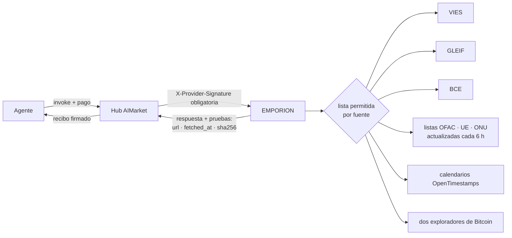
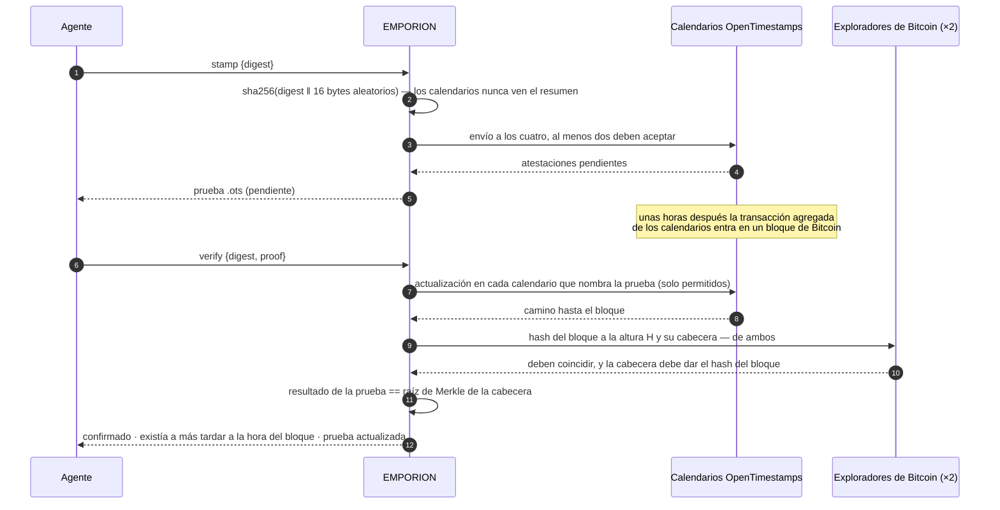

# EMPORION — hechos de registro público para agentes que comercian

<!-- aicom-readme-badges -->
<p align="center">
  <a href="https://github.com/alexar76/emporion/actions/workflows/ci.yml"></a>
  <a href="https://github.com/alexar76/emporion/actions/workflows/pages.yml"></a>
  <a href="https://emporion.modelmarket.dev/"></a>
  <a href="https://alexar76.github.io/emporion/"></a>
  <a href="https://github.com/alexar76/emporion/pkgs/container/emporion"></a>
  =3.11" />
  
  
  
  
  <a href="https://raw.githubusercontent.com/alexar76/emporion/refs/heads/main/docs/badges/coverage.svg"></a>
  <a href="https://github.com/alexar76/emporion/blob/main/LICENSE"></a>
</p>
<!-- /aicom-readme-badges -->

> 🌐 [English](README.md) · [Русский](README.ru.md) · **Español** · [Français](README.fr.md) · [中文](README.zh.md)

Un agente que compra, vende o paga necesita hechos que ningún modelo puede inventar: si este número
de IVA es válido, quién es esta empresa, cuál fue el tipo del euro aquel día, si este monedero está
en una lista de sanciones y si puedo probar que este documento existía ayer. EMPORION responde cada
uno desde el **registro público** —la Comisión Europea, GLEIF, el BCE, el Tesoro de EE. UU., la UE,
la ONU y Bitcoin— y firma cada respuesta junto con **de dónde viene, cuándo se obtuvo y el SHA-256
de lo que devolvió la fuente**.

*Emporion* (ἐμπόριον): el puesto comercial de una ciudad griega, donde los mercaderes se reunían y
liquidaban.

## Capacidades

| Capacidad | Precio | Qué responde | Fuente |
|---|---|---|---|
| `emporion.vat.check@v1` | $0.002 | ¿Es válido hoy este número de IVA de la UE? Nombre, dirección, hora de la consulta — y, si indica **su propio** número de IVA como solicitante, el **identificador de consulta** de VIES: prueba oficial de la comprobación a su nombre | EU VIES |
| `emporion.lei.lookup@v1` | $0.001 | ¿Quién es esta entidad jurídica? Por LEI (dígitos de control verificados localmente) o por nombre (candidatos ordenados): denominación, jurisdicción, forma jurídica, estado, direcciones, renovación, matrices directa y última | GLEIF (CC0) |
| `emporion.fx.rate@v1` | $0.001 | Tipo de referencia del euro para cualquier par en cualquier fecha desde 1999, el día del BCE al que corresponde, tipos cruzados a través del euro en Decimal, un importe redondeado a las unidades menores de la divisa | BCE |
| `emporion.sanctions.screen@v1` | $0.002 | ¿Está esta dirección de monedero o este nombre en una lista pública de sanciones? OFAC SDN (unas 510 direcciones de moneda digital), listas de la UE y la ONU, con la fecha y el SHA-256 de cada lista | OFAC · UE · ONU |
| `emporion.timestamp.stamp@v1` | $0.001 | Anclar un resumen SHA-256 en Bitcoin mediante los calendarios de OpenTimestamps; devuelve una prueba `.ots` estándar | OpenTimestamps |
| `emporion.timestamp.verify@v1` | $0.001 | Actualizar y verificar una prueba: confirmada cuando su resultado es igual a la raíz de Merkle de un bloque de Bitcoin cuya cabecera coincide en dos exploradores independientes | Bitcoin |
| `emporion.sources@v1` | gratis | Licencia y atribución de cada fuente, las listas de sanciones que se tienen ahora, el último día del BCE | — |



## Confianza, en breve

- **Pruebas en cada respuesta** — la URL de la fuente, la hora de obtención y el SHA-256 de los
  bytes devueltos, además de la licencia y la atribución de la fuente.
- **Dos firmas** — el recibo firmado de la pasarela (oracle-core, Ed25519, ML-DSA híbrido con
  `ORACLE_PQC=1`) y la `X-Provider-Signature` ligada a la petición que verifica el hub.
- **Una fuente que no puede responder no cuesta nada** — la respuesta es `ok:false`, y el hub no
  cobra nada por `ok:false`: un registro de IVA nacional caído, listas de sanciones sin cargar o
  con más de 48 h, menos de dos calendarios, exploradores en desacuerdo.
- **Las peticiones salientes se limitan a una lista por fuente**; las redirecciones se siguen a
  mano y solo hacia los hosts de esa misma fuente; el tamaño de las respuestas está acotado.

## Ejemplos

```bash
H=https://emporion.modelmarket.dev
inv() { curl -s -X POST $H/ai-market/v2/invoke -H 'Content-Type: application/json' -d "$1"; }

inv '{"capability_id":"emporion.vat.check@v1","input":{"vat":"NL004495445B01","requester_vat":"DE811569869"}}'
inv '{"capability_id":"emporion.lei.lookup@v1","input":{"name":"Deutsche Bank"}}'
inv '{"capability_id":"emporion.fx.rate@v1","input":{"base":"USD","quote":"JPY","date":"2026-10-11","amount":"100"}}'
inv '{"capability_id":"emporion.sanctions.screen@v1","input":{"address":"0x…"}}'
inv '{"capability_id":"emporion.timestamp.stamp@v1","input":{"digest":"'"$(sha256sum contract.pdf | cut -d' ' -f1)"'"}}'
```

A través del hub, las mismas llamadas se pagan y reciben recibo:
`POST https://modelmarket.dev/ai-market/v2/invoke` con `"product_id":"emporion"`.

### IVA: el identificador de consulta

VIES emite un identificador de consulta solo a un **número de IVA de la UE válido indicado como
solicitante**. Es la prueba del solicitante y la guarda el solicitante: pase su propio número en
`requester_vat` y el identificador de consulta de la respuesta será prueba, a su nombre, de que comprobó a
su contraparte en `checked_at`. Sin él la comprobación se hace igualmente; la respuesta explica
cómo obtener el número.

### Tipos de cambio: qué día

Un tipo «en» una fecha es la última publicación del BCE en esa fecha o antes, y la respuesta nombra
ese día (`ecb_date`): un domingo se valora al tipo del viernes, de forma visible. Una divisa que el
BCE dejó de cotizar (el RUB desde marzo de 2022) se rechaza en lugar de responder con un tipo de
hace años.

### Sanciones: una consulta, no una determinación

Un monedero se compara de forma exacta (direcciones EVM y bech32 sin distinguir mayúsculas). Un
nombre se compara como conjunto de palabras —orden, mayúsculas, tildes y formas jurídicas no
importan («DOE, John» es «John Doe»); una palabra con una errata cuenta 0,9 y nunca se lee como el
mismo nombre; y si todas las palabras pedidas están en un nombre más largo (un patronímico, un
segundo nombre) también coincide. El umbral por defecto es 0,85; cada coincidencia dice qué nombre
coincidió y su puntuación.

**Una coincidencia es motivo para mirar más de cerca; su ausencia no es una autorización.** Los
nombres se repiten y los alias son incompletos. Cada respuesta lo dice y nombra las listas usadas
con sus fechas de publicación y SHA-256. Una lista desactualizada se rechaza, no se usa.

### Sellos de tiempo



La prueba es un archivo OpenTimestamps estándar: se verifica con cualquier cliente de
OpenTimestamps, sin EMPORION. El ejemplo de referencia (`hello-world.txt`) se verifica hasta el
bloque 358 391, 28-05-2015.

## Límites honestos

- VIES responde lo que responde el registro nacional en ese momento; algunos Estados no devuelven
  nombre ni dirección. EMPORION no guarda nada.
- GLEIF cubre las entidades que tienen LEI — muchas empresas pequeñas no lo tienen.
- Los tipos de referencia son informativos, no para operar.
- La consulta de sanciones es una búsqueda en tres listas públicas, no asesoramiento jurídico ni un
  programa de cumplimiento; no incluye listas de otras jurisdicciones.
- Un sello de tiempo prueba la existencia a más tardar a la hora de un bloque, no la autoría.

## Ejecutarlo

```bash
# desde este repositorio
docker build -f Dockerfile.standalone -t emporion .
docker run -d --name emporion -p 127.0.0.1:9351:9351 -v emporion-data:/data \
  -e EMPORION_PUBLIC_URL=http://127.0.0.1:9351 emporion
curl -s http://127.0.0.1:9351/health
```

En el monorepo [aicom](https://github.com/alexar76/aicom) lo mismo se ejecuta desde su raíz con
`docker compose -f emporion/docker-compose.yml up -d --build`. `EMPORION_PUBLIC_URL` es la dirección
por la que llegan los compradores; se escribe en el manifiesto firmado.

Producción, desde el monorepo aicom: `./scripts/deploy_emporion.sh --remote <host>` lo publica en
`https://modelmarket.dev/providers/emporion/` detrás del nginx existente (un fragmento, con copia de
seguridad y `nginx -t` antes de recargar), conserva la imagen en marcha como `emporion:prev` y
revierte una compilación que no arranca sana. Memoria en reposo ≈ 200 MB; el contenedor está
limitado a 768 MB. Se ejecuta como uid 10001. Su propia dirección es https://emporion.modelmarket.dev/:
la página para las personas en `/` y la misma API para los agentes en el resto de rutas
([`deploy/nginx/emporion.modelmarket.dev.conf`](https://github.com/alexar76/aicom/blob/main/deploy/nginx/emporion.modelmarket.dev.conf));
la ruta `/providers/emporion/` sigue siendo la dirección con la que federa el hub.

| Variable | Por defecto | Significado |
|---|---|---|
| `EMPORION_PUBLIC_URL` | `https://modelmarket.dev/providers/emporion` | URL base en el manifiesto |
| `EMPORION_PORT` | `9351` | puerto |
| `EMPORION_RATE_LIMIT` | `120` | invocaciones por minuto por cliente |
| `EMPORION_CORS_ORIGINS` | vacío (ningún origen de navegador) | lista CORS |
| `ORACLE_PQC` | `1` en compose | firmas híbridas ML-DSA-65 |

Pruebas: `pip install -e "vendor/oracle-core[pqc]" -e '.[dev]' && pytest` (en el monorepo:
`-e ../oracles/core`) — 84 pruebas sobre extractos de respuestas reales, ninguna llega a una fuente
en vivo; en el monorepo la cadena canónica firmada se comprueba además byte a byte con la propia
función del hub.

## Fuentes y licencias

| Fuente | Licencia | Atribución en las respuestas |
|---|---|---|
| EU VIES | política de reutilización de la Comisión Europea (Decisión 2011/833/UE) | European Commission, VIES |
| GLEIF | CC0 1.0 | Global Legal Entity Identifier Foundation (GLEIF), CC0 |
| BCE | reproducción citando la fuente | Source: European Central Bank |
| OFAC SDN | obra del Gobierno de EE. UU. (dominio público) | U.S. Department of the Treasury, OFAC |
| Archivos de sanciones financieras de la UE | política de reutilización de la Comisión Europea | European Commission, FSF |
| Lista consolidada de la ONU | información pública de la ONU | United Nations Security Council Consolidated List |
| OpenTimestamps | calendarios públicos gratuitos | OpenTimestamps (opentimestamps.org) |

Código: MIT — véase [LICENSE](LICENSE). La biblioteca de referencia de OpenTimestamps que usa es LGPL-3.0.
