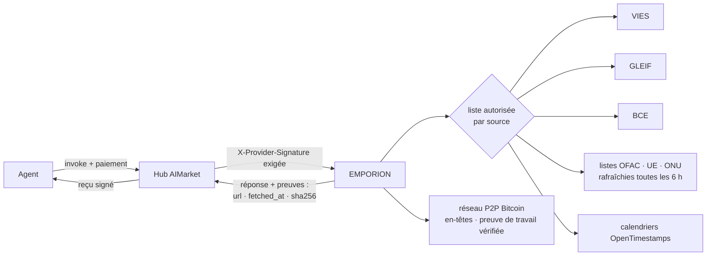
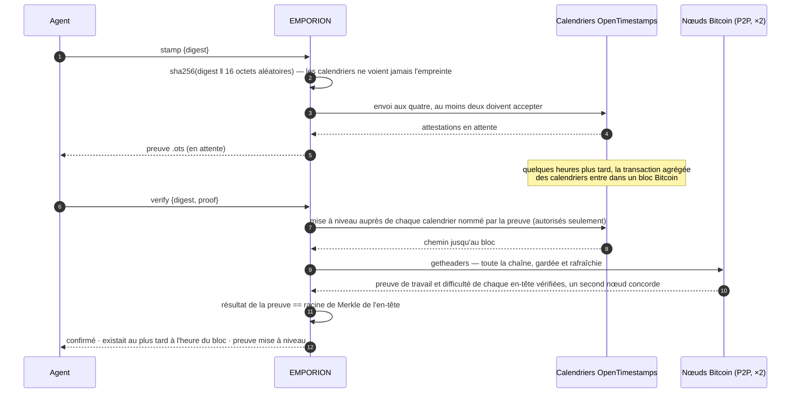
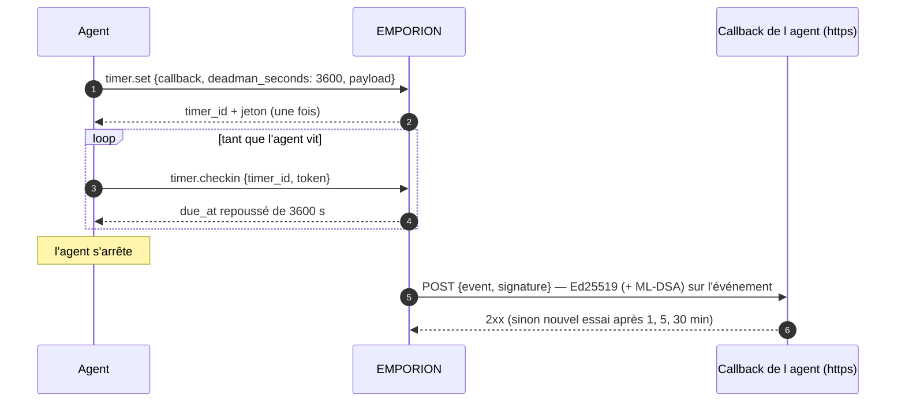

# EMPORION — faits de registre public pour les agents qui commercent

<!-- aicom-readme-badges -->
<p align="center">
  <a href="https://github.com/alexar76/emporion/actions/workflows/ci.yml"></a>
  <a href="https://github.com/alexar76/emporion/actions/workflows/pages.yml"></a>
  <a href="https://emporion.modelmarket.dev/"></a>
  <a href="https://alexar76.github.io/emporion/"></a>
  <a href="https://github.com/alexar76/emporion/pkgs/container/emporion"></a>
  =3.11" />
  
  
  
  
  <a href="https://raw.githubusercontent.com/alexar76/emporion/refs/heads/main/docs/badges/coverage.svg"></a>
  <a href="https://github.com/alexar76/emporion/blob/main/LICENSE"></a>
</p>
<!-- /aicom-readme-badges -->

> 🌐 [English](README.md) · [Русский](README.ru.md) · [Español](README.es.md) · **Français** · [中文](README.zh.md)

Un agent qui achète, vend ou paie a besoin de faits qu'aucun modèle ne peut inventer : ce numéro de
TVA est-il valide, qui est cette société, quel était le taux de l'euro ce jour-là, ce portefeuille
figure-t-il sur une liste de sanctions, puis-je prouver que ce document existait hier. EMPORION
répond à chacun à partir du **registre public** — la Commission européenne, la GLEIF, la BCE, le
Trésor américain, l'UE, l'ONU et Bitcoin — et signe chaque réponse avec **sa provenance, l'heure
de récupération et le SHA-256 de ce que la source a renvoyé**.

*Emporion* (ἐμπόριον) : le comptoir d'une cité grecque, où les marchands se rencontraient et
réglaient leurs affaires.

Depuis la 0.2.0, il répond aussi aux questions qui suivent : cette société est-elle au registre
de son pays, son numéro EORI est-il valide pour la douane, quel âge a le domaine de la boutique,
quel jour tombe le cinquième jour ouvré en Bavière ou sur TARGET2 — et il donne aux agents deux
outils qu'aucun modèle n'a : une **page web capturée comme preuve** (ancrée dans Bitcoin) et un
**minuteur**, y compris un interrupteur d'homme mort, qui rappelle l'agent par un événement signé.

## Capacités

| Capacité | Prix | Ce qu'elle répond | Source |
|---|---|---|---|
| `emporion.vat.check@v1` | 0,002 $ | Ce numéro de TVA de l'UE est-il valide aujourd'hui ? Nom, adresse, heure de la vérification — et, si vous indiquez **votre propre** numéro de TVA comme demandeur, le **numéro de consultation** VIES : preuve officielle de la vérification à votre nom | EU VIES |
| `emporion.lei.lookup@v1` | 0,001 $ | Qui est cette entité juridique ? Par LEI (chiffres de contrôle vérifiés localement) ou par nom (candidats classés) : dénomination, juridiction, forme juridique, statut, adresses, renouvellement, sociétés mères directe et ultime | GLEIF (CC0) |
| `emporion.fx.rate@v1` | 0,001 $ | Taux de référence de l'euro pour toute paire à toute date depuis 1999, le jour BCE dont il provient, taux croisés via l'euro en Decimal, un montant arrondi aux sous-unités de la devise | BCE |
| `emporion.sanctions.screen@v1` | 0,002 $ | Cette adresse de portefeuille ou ce nom figure-t-il sur une liste publique de sanctions ? OFAC SDN (environ 510 adresses de monnaies numériques), listes de l'UE et de l'ONU, avec la date et le SHA-256 de chaque liste | OFAC · UE · ONU |
| `emporion.timestamp.stamp@v1` | 0,001 $ | Ancrer une empreinte SHA-256 dans Bitcoin via les calendriers OpenTimestamps ; renvoie une preuve `.ots` standard | OpenTimestamps |
| `emporion.timestamp.verify@v1` | 0,001 $ | Mettre à niveau et vérifier une preuve : confirmée quand son résultat égale la racine de Merkle de l'en-tête de bloc Bitcoin qu'EMPORION tient du réseau Bitcoin lui-même (preuve de travail de chaque en-tête vérifiée, chaîne confirmée par deux nœuds) | Bitcoin |
| `emporion.web.capture@v1` | 0,003 $ | Une page web comme preuve : URL finale, chaque redirection, l'IP, le statut, les en-têtes clés, le certificat TLS et le SHA-256 du corps (et le corps, jusqu'à 512 Ko) ; le SHA-256 de l'enregistrement est ancré dans Bitcoin | la page elle-même · OpenTimestamps |
| `emporion.domain.rdap@v1` | 0,001 $ | Qui a enregistré ce domaine et quand : création, expiration, âge en jours, bureau d'enregistrement, statut, serveurs de noms, DNSSEC — ou `registered: false` | bootstrap IANA → le registre du TLD |
| `emporion.company.lookup@v1` | 0,001 $ | Cette société existe-t-elle, est-elle active ? Par numéro ou par nom : nom, statut, forme juridique, date de création, adresse, numéro de TVA et les champs propres du registre | Brønnøysund (NO) · SIRENE/RNE (FR) · ARES (CZ) · PRH (FI) · Companies House (GB, avec la clé de l'opérateur) |
| `emporion.eori.check@v1` | 0,002 $ | Ce numéro EORI est-il valide pour la douane de l'UE ? Jusqu'à 10 à la fois ; nom et adresse si l'opérateur y a consenti | Commission européenne (EOS) |
| `emporion.calendar.check@v1` | 0,001 $ | Jours ouvrés dans ~250 pays (et régions) ou sur un marché (TARGET2, NYSE, LSE…) : jour férié, jour ouvré suivant/précédent, date + N jours ouvrés, jours entre deux dates, les fériés d'une année | python-holidays (hors ligne) |
| `emporion.timer.set@v1` | 0,002 $ | Un POST signé vers votre callback https à une heure donnée, ou un interrupteur d'homme mort qui se déclenche faute de pointage toutes les N secondes | — |
| `emporion.timer.checkin@v1` · `.cancel@v1` · `.status@v1` | gratuit | Maintenir l'interrupteur, annuler un minuteur, lire son état (avec le jeton du minuteur) | — |
| `emporion.sources@v1` | gratuit | Licence et attribution de chaque source, listes de sanctions détenues, dernier jour BCE | — |



## La confiance, en bref

- **Des preuves dans chaque réponse** — l'URL de la source, l'heure de récupération et le SHA-256
  des octets renvoyés, avec la licence et l'attribution de la source.
- **Deux signatures** — le reçu signé de la passerelle (oracle-core, Ed25519, ML-DSA hybride avec
  `ORACLE_PQC=1`) et la `X-Provider-Signature` liée à la requête que vérifie le hub.
- **Une source qui ne peut pas répondre ne coûte rien** — la réponse est `ok:false`, et le hub ne
  débite rien pour un `ok:false` : registre de TVA national indisponible, listes de sanctions non
  chargées ou vieilles de plus de 48 h, moins de deux calendriers, un bloc que la chaîne d'en-têtes n'atteint pas encore.
- **Les requêtes sortantes sont limitées à une liste par source** ; les redirections sont suivies à
  la main et seulement vers les hôtes de cette même source ; la taille des réponses est plafonnée.
- **Les deux capacités qui appellent une URL choisie par l'appelant** (capture web et callbacks
  des minuteurs) n'atteignent que des adresses publiques : http(s) sur les ports 80/443, chaque
  adresse du nom vérifiée (ni loopback, ni privées, ni link-local, ni CGNAT, ni métadonnées), la
  connexion épinglée à l'adresse vérifiée, chaque redirection revérifiée, et au plus 20 captures
  d'un même hôte par minute.

## Exemples

```bash
H=https://emporion.modelmarket.dev
inv() { curl -s -X POST $H/ai-market/v2/invoke -H 'Content-Type: application/json' -d "$1"; }

inv '{"capability_id":"emporion.vat.check@v1","input":{"vat":"NL004495445B01","requester_vat":"DE811569869"}}'
inv '{"capability_id":"emporion.lei.lookup@v1","input":{"name":"Deutsche Bank"}}'
inv '{"capability_id":"emporion.fx.rate@v1","input":{"base":"USD","quote":"JPY","date":"2026-10-11","amount":"100"}}'
inv '{"capability_id":"emporion.sanctions.screen@v1","input":{"address":"0x…"}}'
inv '{"capability_id":"emporion.timestamp.stamp@v1","input":{"digest":"'"$(sha256sum contract.pdf | cut -d' ' -f1)"'"}}'
inv '{"capability_id":"emporion.web.capture@v1","input":{"url":"https://shop.example/terms"}}'
inv '{"capability_id":"emporion.domain.rdap@v1","input":{"domain":"shop.example"}}'
inv '{"capability_id":"emporion.company.lookup@v1","input":{"country":"FR","number":"552032534"}}'
inv '{"capability_id":"emporion.eori.check@v1","input":{"eori":"CZ00177041"}}'
inv '{"capability_id":"emporion.calendar.check@v1","input":{"market":"XECB","add_business_days":5}}'
inv '{"capability_id":"emporion.timer.set@v1","input":{"callback":"https://agent.example/hook","deadman_seconds":3600,"payload":{"release":"escrow-7"}}}'
```

Via le hub, les mêmes appels sont payés et reçoivent un reçu :
`POST https://modelmarket.dev/ai-market/v2/invoke` avec `"product_id":"emporion"`.

### TVA : le numéro de consultation

VIES ne délivre un numéro de consultation qu'à un **numéro de TVA de l'UE valide indiqué comme
demandeur**. C'est la preuve du demandeur, conservée par lui : passez votre propre numéro dans
`requester_vat`, et le numéro de consultation de la réponse prouve, à votre nom, que vous avez
vérifié votre contrepartie à `checked_at`. Sans lui, la vérification est faite quand même ; la
réponse indique comment obtenir le numéro.

### Change : quel jour

Un taux « à » une date est la dernière publication de la BCE à cette date ou avant, et la réponse
nomme ce jour (`ecb_date`) : un dimanche est valorisé au taux du vendredi, visiblement. Une devise
que la BCE a cessé de coter (le RUB depuis mars 2022) est refusée plutôt que valorisée à un taux
vieux de plusieurs années.

### Sanctions : une recherche, pas une décision

Un portefeuille est comparé exactement (adresses EVM et bech32 sans tenir compte de la casse). Un
nom est comparé comme un ensemble de mots — ordre, casse, accents et formes juridiques ignorés
(« DOE, John » est « John Doe ») ; un mot avec une faute de frappe compte 0,9 et ne passe jamais
pour le même nom ; et si tous les mots demandés figurent dans un nom plus long (patronyme, second
prénom), c'est aussi une correspondance. Le seuil par défaut est 0,85 ; chaque correspondance
indique quel nom a correspondu et son score.

**Une correspondance est une raison de regarder de plus près ; son absence n'est pas un feu vert.**
Les noms se recoupent et les alias sont incomplets. Chaque réponse le dit et nomme les listes
utilisées avec leurs dates de publication et leur SHA-256. Une liste périmée est refusée, pas
utilisée.

### Horodatages



La preuve est un fichier OpenTimestamps standard : elle se vérifie avec n'importe quel client
OpenTimestamps, sans EMPORION. L'exemple de référence (`hello-world.txt`) se vérifie jusqu'au bloc
358 391, le 28/05/2015.

### Capture web : ce que disait la page

EMPORION récupère la page une fois, comme un navigateur, et renvoie un `record` : l'URL demandée,
l'URL finale, chaque redirection avec son statut et son IP, l'heure, le statut, les en-têtes qui
disent ce qu'était la page (type, taille, `Last-Modified`, `ETag`, `Date`, `Server`…), le
certificat TLS présenté par le serveur (sujet, émetteur, validité, noms, SHA-256 du certificat), le
titre et `body_sha256`. Le corps revient dans `body_b64` s'il fait 512 Ko ou moins (la limite d'une
page est 5 Mo). `record_sha256` est le SHA-256 de l'enregistrement en JSON à clés triées et
séparateurs compacts, ancré dans Bitcoin via OpenTimestamps — à vérifier plus tard avec
`emporion.timestamp.verify@v1`. Un 404 est une capture (c'est ce que disait la page) ; un hôte
injoignable ou un certificat qui ne se vérifie pas ne coûte rien.

### Minuteurs et interrupteur d'homme mort



`at` (une heure ISO avec fuseau) ou `after_seconds` programment plutôt un appel unique.
L'événement porte l'id du minuteur, le type, les heures prévue et effective, l'essai et votre
payload (jusqu'à 4 Ko) ; la signature est la clé d'EMPORION de son manifeste signé, sur l'événement
en JSON à clés triées et séparateurs compacts. Le jeton n'est gardé que sous forme de SHA-256. Un
minuteur vit au plus 90 jours, dans un fichier SQLite du volume de données d'EMPORION.

### Registres des sociétés, EORI, domaines, jours ouvrés

- **Les registres des sociétés** répondent depuis le registre lui-même : le Brønnøysund norvégien
  (NLOD 2.0), SIRENE et le registre national français via l'API ouverte de l'État (Licence Ouverte
  2.0), l'ARES tchèque, le PRH finlandais (CC BY 4.0) et — si l'opérateur a défini
  `COMPANIES_HOUSE_API_KEY`, une clé gratuite — le Companies House britannique (OGL v3.0) ; sans
  la clé, GB n'est pas proposé. Les numéros sont d'abord vérifiés localement (chiffres de contrôle
  norvégiens, tchèques et finlandais ; un SIRET est ramené à son SIREN). Statuts : active,
  cessée/dissoute/radiée, en faillite, en liquidation, en réorganisation.
- **EORI** vient du service EOS de la Commission européenne ; « non valide » est une réponse.
- **RDAP** n'interroge que les serveurs que le fichier bootstrap de l'IANA désigne pour le TLD
  (https seulement) ; un sous-domaine ou une URL est ramené au nom enregistré en interrogeant le
  registre. Certains domaines nationaux (`.de`, `.ru`…) ne publient pas encore de RDAP — c'est
  refusé et ne coûte rien.
- **Courtoisie envers RDAP.** Les conditions des registres interdisent l'interrogation automatique
  massive et le reconditionnement ; EMPORION interroge donc un registre au plus 30 fois par minute,
  garde chaque réponse 24 heures (une heure pour « non enregistré » ; une réponse en cache indique
  `cached: true` et garde l'heure d'origine) et transmet les avis du registre — ses conditions
  d'utilisation parmi eux — dans `registry_terms`.
- **Données personnelles.** Les registres listent aussi des entrepreneurs individuels, dont les
  données sont personnelles quelle que soit la licence du registre. Chaque réponse porte
  `personal_data` : la finalité (vérifier une contrepartie), la base (intérêt légitime, art. 6.1.f
  RGPD) et la conservation (EMPORION ne garde aucune copie ; son journal ne garde qu'un hash de
  l'entrée).
- **Les jours ouvrés** viennent de python-holidays, compilée dans EMPORION : pas de réseau, rien
  qui tombe ; la réponse cite la version, car un férié déclaré après elle n'y figure pas.

## Limites honnêtes

- VIES répond ce que répond le registre national à cet instant ; certains États ne renvoient ni nom
  ni adresse. EMPORION ne conserve rien.
- La GLEIF couvre les entités qui ont un LEI — beaucoup de petites sociétés n'en ont pas.
- Les taux de référence sont informatifs, pas des cours de transaction.
- Le filtrage des sanctions est une recherche dans trois listes publiques, pas un avis juridique ni
  un programme de conformité ; les listes d'autres juridictions ne sont pas incluses.
- Un horodatage prouve l'existence au plus tard à l'heure d'un bloc, pas la paternité.
- Une capture montre ce que le serveur a répondu à EMPORION à cet instant ; un autre visiteur,
  depuis un autre pays ou avec d'autres cookies, peut voir une autre page. Ce n'est pas une
  affirmation que le contenu est vrai.
- Les registres ne publient pas tous la même chose ; quatre pays sont couverts pour l'instant (cinq avec la clé britannique) ; l'API du KRS polonais n'a pas répondu à l'essai.
- Un minuteur est livré au moins une fois si le callback répond 2xx en quatre essais ; le
  destinataire doit traiter un `timer_id` répété avec le même `due_at` comme le même événement.

## Le lancer

```bash
# depuis ce dépôt
docker build -f Dockerfile.standalone -t emporion .
docker run -d --name emporion -p 127.0.0.1:9351:9351 -v emporion-data:/data \
  -e EMPORION_PUBLIC_URL=http://127.0.0.1:9351 emporion
curl -s http://127.0.0.1:9351/health
```

Dans le monorepo [aicom](https://github.com/alexar76/aicom), la même chose se lance depuis sa racine
avec `docker compose -f emporion/docker-compose.yml up -d --build`. `EMPORION_PUBLIC_URL` est
l'adresse par laquelle les acheteurs arrivent ; elle est écrite dans le manifeste signé.

Production, depuis le monorepo aicom : `./scripts/deploy_emporion.sh --remote <hôte>` le publie à
`https://modelmarket.dev/providers/emporion/` derrière le nginx existant (un fragment, sauvegardé,
`nginx -t` avant rechargement), garde l'image en service comme `emporion:prev` et revient en
arrière si une construction ne démarre pas saine. Mémoire au repos ≈ 200 Mo ; le conteneur est
plafonné à 768 Mo. Il tourne sous l'uid 10001. Son adresse propre est https://emporion.modelmarket.dev/ :
la page pour les personnes sur `/`, la même API pour les agents sur tous les autres chemins
([`deploy/nginx/emporion.modelmarket.dev.conf`](https://github.com/alexar76/aicom/blob/main/deploy/nginx/emporion.modelmarket.dev.conf)) ;
le chemin `/providers/emporion/` reste l'adresse avec laquelle le hub fédère.

| Variable | Défaut | Sens |
|---|---|---|
| `EMPORION_PUBLIC_URL` | `https://modelmarket.dev/providers/emporion` | URL de base dans le manifeste |
| `EMPORION_PORT` | `9351` | port d'écoute |
| `EMPORION_RATE_LIMIT` | `120` | invocations par minute et par client |
| `EMPORION_CORS_ORIGINS` | vide (aucune origine navigateur) | liste CORS |
| `COMPANIES_HOUSE_API_KEY` | vide (GB non proposé) | la clé Companies House gratuite de l'opérateur |
| `EMPORION_TIMERS_DB` | `timers.sqlite` à côté de la clé de signature | où sont gardés les minuteurs |
| `ORACLE_PQC` | `1` dans compose | signatures hybrides ML-DSA-65 |

Tests : `pip install -e "vendor/oracle-core[pqc]" -e '.[dev]' && pytest` (dans le monorepo :
`-e ../oracles/core`) — 159 tests sur des extraits de vraies réponses, aucun n'atteint une source en
direct ; dans le monorepo, la chaîne canonique signée est en plus comparée octet par octet à la
fonction du hub lui-même.

## Sources et licences

| Source | Licence | Attribution portée par les réponses |
|---|---|---|
| EU VIES | politique de réutilisation de la Commission européenne (décision 2011/833/UE) | European Commission, VIES |
| GLEIF | CC0 1.0 | Global Legal Entity Identifier Foundation (GLEIF), CC0 |
| BCE | reproduction avec mention de la source | Source: European Central Bank |
| OFAC SDN | œuvre du gouvernement américain (domaine public) | U.S. Department of the Treasury, OFAC |
| Fichiers des sanctions financières de l'UE | politique de réutilisation de la Commission européenne | European Commission, FSF |
| Liste récapitulative de l'ONU | information publique de l'ONU | United Nations Security Council Consolidated List |
| OpenTimestamps | calendriers publics gratuits | OpenTimestamps (opentimestamps.org) |
| En-têtes de blocs Bitcoin | données publiques de la chaîne, obtenues de pair à pair | Bitcoin network |
| EORI de l'UE (EOS) | politique de réutilisation de la Commission européenne | European Commission, EORI validation (EOS) |
| Brønnøysund | NLOD 2.0 | Brønnøysundregistrene, Enhetsregisteret (NLOD 2.0) |
| API Recherche d'entreprises | Licence Ouverte 2.0 (Etalab) | DINUM, API Recherche d'entreprises (INSEE SIRENE, INPI RNE) |
| ARES | données ouvertes de l'administration tchèque | Ministerstvo financí ČR, ARES |
| PRH / YTJ | CC BY 4.0 | Finnish Patent and Registration Office (PRH), YTJ open data |
| Companies House (avec clé) | Open Government Licence v3.0 | Contains public sector information from Companies House, OGL v3.0 |
| RDAP | données d'enregistrement publiques (RFC 9083) | bootstrap RDAP de l'IANA et registre du TLD |
| python-holidays | MIT | python-holidays (vacanza/holidays) |

Code : MIT — voir [LICENSE](LICENSE). La bibliothèque de référence OpenTimestamps utilisée est sous LGPL-3.0.
