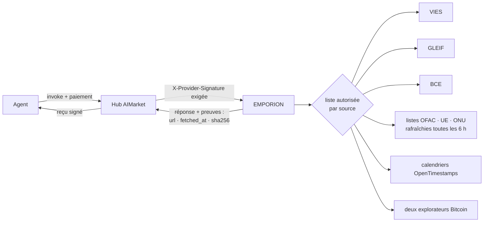
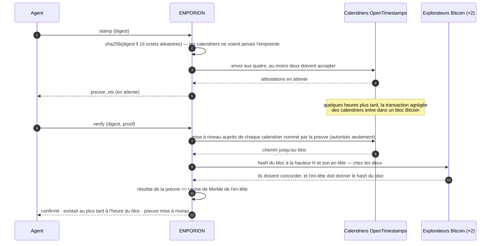

# EMPORION — faits de registre public pour les agents qui commercent

<!-- aicom-readme-badges -->
<p align="center">
  <a href="https://github.com/alexar76/emporion/actions/workflows/ci.yml"></a>
  <a href="https://github.com/alexar76/emporion/actions/workflows/pages.yml"></a>
  <a href="https://emporion.modelmarket.dev/"></a>
  <a href="https://alexar76.github.io/emporion/"></a>
  <a href="https://github.com/alexar76/emporion/pkgs/container/emporion"></a>
  =3.11" />
  
  
  
  
  <a href="https://raw.githubusercontent.com/alexar76/emporion/refs/heads/main/docs/badges/coverage.svg"></a>
  <a href="https://github.com/alexar76/emporion/blob/main/LICENSE"></a>
</p>
<!-- /aicom-readme-badges -->

> 🌐 [English](README.md) · [Русский](README.ru.md) · [Español](README.es.md) · **Français** · [中文](README.zh.md)

Un agent qui achète, vend ou paie a besoin de faits qu'aucun modèle ne peut inventer : ce numéro de
TVA est-il valide, qui est cette société, quel était le taux de l'euro ce jour-là, ce portefeuille
figure-t-il sur une liste de sanctions, puis-je prouver que ce document existait hier. EMPORION
répond à chacun à partir du **registre public** — la Commission européenne, la GLEIF, la BCE, le
Trésor américain, l'UE, l'ONU et Bitcoin — et signe chaque réponse avec **sa provenance, l'heure
de récupération et le SHA-256 de ce que la source a renvoyé**.

*Emporion* (ἐμπόριον) : le comptoir d'une cité grecque, où les marchands se rencontraient et
réglaient leurs affaires.

## Capacités

| Capacité | Prix | Ce qu'elle répond | Source |
|---|---|---|---|
| `emporion.vat.check@v1` | 0,002 $ | Ce numéro de TVA de l'UE est-il valide aujourd'hui ? Nom, adresse, heure de la vérification — et, si vous indiquez **votre propre** numéro de TVA comme demandeur, le **numéro de consultation** VIES : preuve officielle de la vérification à votre nom | EU VIES |
| `emporion.lei.lookup@v1` | 0,001 $ | Qui est cette entité juridique ? Par LEI (chiffres de contrôle vérifiés localement) ou par nom (candidats classés) : dénomination, juridiction, forme juridique, statut, adresses, renouvellement, sociétés mères directe et ultime | GLEIF (CC0) |
| `emporion.fx.rate@v1` | 0,001 $ | Taux de référence de l'euro pour toute paire à toute date depuis 1999, le jour BCE dont il provient, taux croisés via l'euro en Decimal, un montant arrondi aux sous-unités de la devise | BCE |
| `emporion.sanctions.screen@v1` | 0,002 $ | Cette adresse de portefeuille ou ce nom figure-t-il sur une liste publique de sanctions ? OFAC SDN (environ 510 adresses de monnaies numériques), listes de l'UE et de l'ONU, avec la date et le SHA-256 de chaque liste | OFAC · UE · ONU |
| `emporion.timestamp.stamp@v1` | 0,001 $ | Ancrer une empreinte SHA-256 dans Bitcoin via les calendriers OpenTimestamps ; renvoie une preuve `.ots` standard | OpenTimestamps |
| `emporion.timestamp.verify@v1` | 0,001 $ | Mettre à niveau et vérifier une preuve : confirmée quand son résultat égale la racine de Merkle d'un bloc Bitcoin dont l'en-tête concorde chez deux explorateurs indépendants | Bitcoin |
| `emporion.sources@v1` | gratuit | Licence et attribution de chaque source, listes de sanctions détenues, dernier jour BCE | — |



## La confiance, en bref

- **Des preuves dans chaque réponse** — l'URL de la source, l'heure de récupération et le SHA-256
  des octets renvoyés, avec la licence et l'attribution de la source.
- **Deux signatures** — le reçu signé de la passerelle (oracle-core, Ed25519, ML-DSA hybride avec
  `ORACLE_PQC=1`) et la `X-Provider-Signature` liée à la requête que vérifie le hub.
- **Une source qui ne peut pas répondre ne coûte rien** — la réponse est `ok:false`, et le hub ne
  débite rien pour un `ok:false` : registre de TVA national indisponible, listes de sanctions non
  chargées ou vieilles de plus de 48 h, moins de deux calendriers, explorateurs en désaccord.
- **Les requêtes sortantes sont limitées à une liste par source** ; les redirections sont suivies à
  la main et seulement vers les hôtes de cette même source ; la taille des réponses est plafonnée.

## Exemples

```bash
H=https://emporion.modelmarket.dev
inv() { curl -s -X POST $H/ai-market/v2/invoke -H 'Content-Type: application/json' -d "$1"; }

inv '{"capability_id":"emporion.vat.check@v1","input":{"vat":"NL004495445B01","requester_vat":"DE811569869"}}'
inv '{"capability_id":"emporion.lei.lookup@v1","input":{"name":"Deutsche Bank"}}'
inv '{"capability_id":"emporion.fx.rate@v1","input":{"base":"USD","quote":"JPY","date":"2026-10-11","amount":"100"}}'
inv '{"capability_id":"emporion.sanctions.screen@v1","input":{"address":"0x…"}}'
inv '{"capability_id":"emporion.timestamp.stamp@v1","input":{"digest":"'"$(sha256sum contract.pdf | cut -d' ' -f1)"'"}}'
```

Via le hub, les mêmes appels sont payés et reçoivent un reçu :
`POST https://modelmarket.dev/ai-market/v2/invoke` avec `"product_id":"emporion"`.

### TVA : le numéro de consultation

VIES ne délivre un numéro de consultation qu'à un **numéro de TVA de l'UE valide indiqué comme
demandeur**. C'est la preuve du demandeur, conservée par lui : passez votre propre numéro dans
`requester_vat`, et le numéro de consultation de la réponse prouve, à votre nom, que vous avez
vérifié votre contrepartie à `checked_at`. Sans lui, la vérification est faite quand même ; la
réponse indique comment obtenir le numéro.

### Change : quel jour

Un taux « à » une date est la dernière publication de la BCE à cette date ou avant, et la réponse
nomme ce jour (`ecb_date`) : un dimanche est valorisé au taux du vendredi, visiblement. Une devise
que la BCE a cessé de coter (le RUB depuis mars 2022) est refusée plutôt que valorisée à un taux
vieux de plusieurs années.

### Sanctions : une recherche, pas une décision

Un portefeuille est comparé exactement (adresses EVM et bech32 sans tenir compte de la casse). Un
nom est comparé comme un ensemble de mots — ordre, casse, accents et formes juridiques ignorés
(« DOE, John » est « John Doe ») ; un mot avec une faute de frappe compte 0,9 et ne passe jamais
pour le même nom ; et si tous les mots demandés figurent dans un nom plus long (patronyme, second
prénom), c'est aussi une correspondance. Le seuil par défaut est 0,85 ; chaque correspondance
indique quel nom a correspondu et son score.

**Une correspondance est une raison de regarder de plus près ; son absence n'est pas un feu vert.**
Les noms se recoupent et les alias sont incomplets. Chaque réponse le dit et nomme les listes
utilisées avec leurs dates de publication et leur SHA-256. Une liste périmée est refusée, pas
utilisée.

### Horodatages



La preuve est un fichier OpenTimestamps standard : elle se vérifie avec n'importe quel client
OpenTimestamps, sans EMPORION. L'exemple de référence (`hello-world.txt`) se vérifie jusqu'au bloc
358 391, le 28/05/2015.

## Limites honnêtes

- VIES répond ce que répond le registre national à cet instant ; certains États ne renvoient ni nom
  ni adresse. EMPORION ne conserve rien.
- La GLEIF couvre les entités qui ont un LEI — beaucoup de petites sociétés n'en ont pas.
- Les taux de référence sont informatifs, pas des cours de transaction.
- Le filtrage des sanctions est une recherche dans trois listes publiques, pas un avis juridique ni
  un programme de conformité ; les listes d'autres juridictions ne sont pas incluses.
- Un horodatage prouve l'existence au plus tard à l'heure d'un bloc, pas la paternité.

## Le lancer

```bash
# depuis ce dépôt
docker build -f Dockerfile.standalone -t emporion .
docker run -d --name emporion -p 127.0.0.1:9351:9351 -v emporion-data:/data \
  -e EMPORION_PUBLIC_URL=http://127.0.0.1:9351 emporion
curl -s http://127.0.0.1:9351/health
```

Dans le monorepo [aicom](https://github.com/alexar76/aicom), la même chose se lance depuis sa racine
avec `docker compose -f emporion/docker-compose.yml up -d --build`. `EMPORION_PUBLIC_URL` est
l'adresse par laquelle les acheteurs arrivent ; elle est écrite dans le manifeste signé.

Production, depuis le monorepo aicom : `./scripts/deploy_emporion.sh --remote <hôte>` le publie à
`https://modelmarket.dev/providers/emporion/` derrière le nginx existant (un fragment, sauvegardé,
`nginx -t` avant rechargement), garde l'image en service comme `emporion:prev` et revient en
arrière si une construction ne démarre pas saine. Mémoire au repos ≈ 200 Mo ; le conteneur est
plafonné à 768 Mo. Il tourne sous l'uid 10001. Son adresse propre est https://emporion.modelmarket.dev/ :
la page pour les personnes sur `/`, la même API pour les agents sur tous les autres chemins
([`deploy/nginx/emporion.modelmarket.dev.conf`](https://github.com/alexar76/aicom/blob/main/deploy/nginx/emporion.modelmarket.dev.conf)) ;
le chemin `/providers/emporion/` reste l'adresse avec laquelle le hub fédère.

| Variable | Défaut | Sens |
|---|---|---|
| `EMPORION_PUBLIC_URL` | `https://modelmarket.dev/providers/emporion` | URL de base dans le manifeste |
| `EMPORION_PORT` | `9351` | port d'écoute |
| `EMPORION_RATE_LIMIT` | `120` | invocations par minute et par client |
| `EMPORION_CORS_ORIGINS` | vide (aucune origine navigateur) | liste CORS |
| `ORACLE_PQC` | `1` dans compose | signatures hybrides ML-DSA-65 |

Tests : `pip install -e "vendor/oracle-core[pqc]" -e '.[dev]' && pytest` (dans le monorepo :
`-e ../oracles/core`) — 84 tests sur des extraits de vraies réponses, aucun n'atteint une source en
direct ; dans le monorepo, la chaîne canonique signée est en plus comparée octet par octet à la
fonction du hub lui-même.

## Sources et licences

| Source | Licence | Attribution portée par les réponses |
|---|---|---|
| EU VIES | politique de réutilisation de la Commission européenne (décision 2011/833/UE) | European Commission, VIES |
| GLEIF | CC0 1.0 | Global Legal Entity Identifier Foundation (GLEIF), CC0 |
| BCE | reproduction avec mention de la source | Source: European Central Bank |
| OFAC SDN | œuvre du gouvernement américain (domaine public) | U.S. Department of the Treasury, OFAC |
| Fichiers des sanctions financières de l'UE | politique de réutilisation de la Commission européenne | European Commission, FSF |
| Liste récapitulative de l'ONU | information publique de l'ONU | United Nations Security Council Consolidated List |
| OpenTimestamps | calendriers publics gratuits | OpenTimestamps (opentimestamps.org) |

Code : MIT — voir [LICENSE](LICENSE). La bibliothèque de référence OpenTimestamps utilisée est sous LGPL-3.0.
