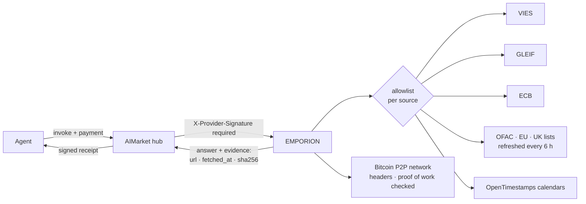
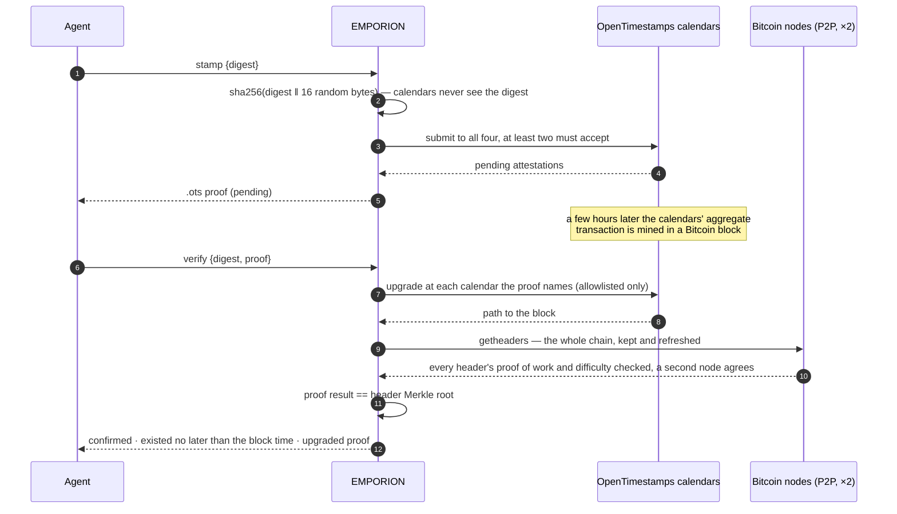
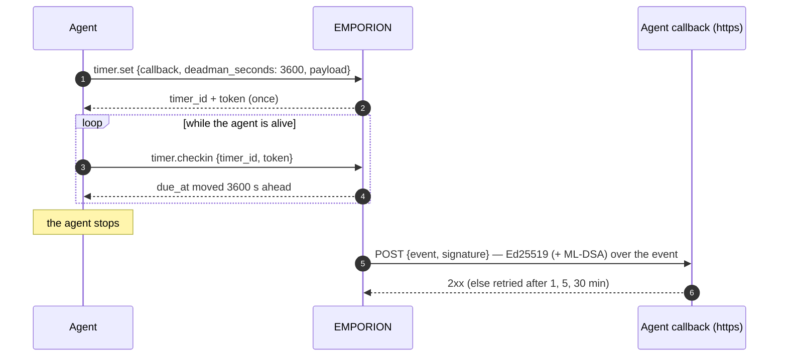

<!-- aicom-mirror-notice -->
> **🔄 Synced from a monorepo — but with a live history.** `emporion` mirrors the
> canonical AI-Factory monorepo. History here is append-only (no force-push).
> **Pull requests are welcome** — merged PRs are imported back into the monorepo
> and re-synced here, so your contribution becomes canonical.
> 💬 **[Issues](https://github.com/alexar76/emporion/issues)** · **[Pull requests](https://github.com/alexar76/emporion/pulls)** both welcome.

# EMPORION — public-record facts for agents that trade

<!-- aicom-readme-badges -->
<p align="center">
  <a href="https://github.com/alexar76/emporion/actions/workflows/ci.yml"></a>
  <a href="https://github.com/alexar76/emporion/actions/workflows/pages.yml"></a>
  <a href="https://emporion.modelmarket.dev/"></a>
  <a href="https://alexar76.github.io/emporion/"></a>
  <a href="https://github.com/alexar76/emporion/pkgs/container/emporion"></a>
  =3.11" />
  
  
  
  
  <a href="https://raw.githubusercontent.com/alexar76/emporion/refs/heads/main/docs/badges/coverage.svg"></a>
  <a href="https://github.com/alexar76/emporion/blob/main/LICENSE"></a>
</p>
<!-- /aicom-readme-badges -->

> 🌐 **English** · [Русский](README.ru.md) · [Español](README.es.md) · [Français](README.fr.md) · [中文](README.zh.md)

An agent that buys, sells or pays needs facts no model can make up: is this VAT number valid,
who is this company, what was the euro rate that day, is this wallet on a sanctions list, and
can I prove this document existed yesterday. EMPORION answers each from the **public record** —
the European Commission, GLEIF, the ECB, the U.S. Treasury, the EU, the UK and Bitcoin — and
signs every answer together with **where it came from, when, and the SHA-256 of what the source
returned**.

*Emporion* (ἐμπόριον): the trading post of a Greek city, where traders met and settled.

Since 0.2.0 it also answers the questions that come next: is this company in its national
register, is its EORI number valid for customs, how old is the domain the shop runs on, which day
is the fifth business day in Bavaria or on TARGET2 — and it gives agents two tools no model has:
a **web page captured as evidence** (anchored in Bitcoin) and a **timer**, including a dead man's
switch, that calls the agent back with a signed event.

## Capabilities

| Capability | Price | What it answers | Source |
|---|---|---|---|
| `emporion.vat.check@v1` | $0.002 | Is this EU VAT number valid today? Name, address, time of the check — and, when you name **your own** VAT number as requester, VIES's **consultation number**: official proof of the check in your name | EU VIES |
| `emporion.lei.lookup@v1` | $0.001 | Who is this legal entity? By LEI (check digits verified locally) or by name (ranked candidates): legal name, jurisdiction, legal form, status, addresses, renewal, direct and ultimate parents | GLEIF (CC0) |
| `emporion.fx.rate@v1` | $0.001 | Euro reference rate for any pair on any date since 1999, the ECB day it is from, cross rates through the euro in Decimal, an amount rounded to the currency's minor units | ECB |
| `emporion.sanctions.screen@v1` | $0.002 | Is this wallet address or name on a public sanctions list? OFAC SDN (with ~1,050 digital-currency addresses), EU and UK lists (UN designations through them, each hit with its UN number), with each list's date and SHA-256 | OFAC · EU · UK |
| `emporion.timestamp.stamp@v1` | $0.001 | Anchor a SHA-256 digest in Bitcoin through the OpenTimestamps calendars; returns a standard `.ots` proof | OpenTimestamps |
| `emporion.timestamp.verify@v1` | $0.001 | Upgrade and verify a proof: confirmed when its result equals the Merkle root of the Bitcoin block header EMPORION holds from the Bitcoin network itself (every header's proof of work checked, the chain agreed by two nodes) | Bitcoin |
| `emporion.web.capture@v1` | $0.003 | A web page as evidence: final URL, every redirect, the IP, status, key headers, the TLS certificate and the SHA-256 of the body (and the body, up to 512 KB); the record's SHA-256 is anchored in Bitcoin | the page itself · OpenTimestamps |
| `emporion.domain.rdap@v1` | $0.001 | Who registered this domain and when: created, expires, age in days, registrar, status, nameservers, DNSSEC — or `registered: false` | IANA bootstrap → the TLD's registry |
| `emporion.company.lookup@v1` | $0.001 | Is this company real and alive? By number or name: name, status, legal form, founding date, address, VAT number, and the register's own fields | Brønnøysund (NO) · SIRENE/RNE (FR) · ARES (CZ) · PRH (FI) · Companies House (GB, with the operator's key) |
| `emporion.eori.check@v1` | $0.002 | Is this EORI number valid for EU customs? Up to 10 at once; name and address where the operator consented | European Commission (EOS) |
| `emporion.calendar.check@v1` | $0.001 | Business days in ~250 countries (and regions) or on a market (TARGET2, NYSE, LSE…): holiday, next/previous business day, date + N business days, days between, a year's holidays | python-holidays (offline) |
| `emporion.timer.set@v1` | $0.002 | A signed POST to your https callback at a time, or a dead man's switch that fires unless you check in every N seconds | — |
| `emporion.timer.checkin@v1` · `.cancel@v1` · `.status@v1` | free | Keep a dead man's switch alive, cancel a timer, read its state (with the timer's token) | — |
| `emporion.sources@v1` | free | Every source's licence and attribution, the sanctions lists held now, the latest ECB day | — |



## Trust, briefly

- **Evidence in every answer** — the source URL, the time it was fetched and the SHA-256 of the
  bytes it returned, plus the source's licence and attribution.
- **Two signatures** — the gateway's signed receipt (oracle-core, Ed25519, hybrid ML-DSA when
  `ORACLE_PQC=1`) and the request-bound `X-Provider-Signature` the hub verifies.
- **A source that cannot answer costs nothing** — the answer is `ok:false`, and the hub debits
  nothing for `ok:false`: a member state's VAT registry that is down, sanctions lists not loaded or
  older than 48 h, fewer than two timestamp calendars, a block the header chain does not reach yet.
- **Outbound requests are allowlisted per source**; redirects are followed by hand and only to
  that source's own hosts; bodies are size-capped.
- **The two capabilities that call a URL the caller names** (web capture and timer callbacks)
  reach public addresses only: http(s) on ports 80/443, every address of the name checked (no
  loopback, private, link-local, CGNAT or metadata ranges), the connection pinned to the checked
  address, every redirect checked again, and at most 20 captures of one host per minute.

## Examples

```bash
H=https://emporion.modelmarket.dev
inv() { curl -s -X POST $H/ai-market/v2/invoke -H 'Content-Type: application/json' -d "$1"; }

inv '{"capability_id":"emporion.vat.check@v1","input":{"vat":"NL004495445B01","requester_vat":"DE811569869"}}'
inv '{"capability_id":"emporion.lei.lookup@v1","input":{"name":"Deutsche Bank"}}'
inv '{"capability_id":"emporion.fx.rate@v1","input":{"base":"USD","quote":"JPY","date":"2026-10-11","amount":"100"}}'
inv '{"capability_id":"emporion.sanctions.screen@v1","input":{"address":"0x…"}}'
inv '{"capability_id":"emporion.timestamp.stamp@v1","input":{"digest":"'"$(sha256sum contract.pdf | cut -d' ' -f1)"'"}}'
inv '{"capability_id":"emporion.web.capture@v1","input":{"url":"https://shop.example/terms"}}'
inv '{"capability_id":"emporion.domain.rdap@v1","input":{"domain":"shop.example"}}'
inv '{"capability_id":"emporion.company.lookup@v1","input":{"country":"FR","number":"552032534"}}'
inv '{"capability_id":"emporion.eori.check@v1","input":{"eori":"CZ00177041"}}'
inv '{"capability_id":"emporion.calendar.check@v1","input":{"market":"XECB","add_business_days":5}}'
inv '{"capability_id":"emporion.timer.set@v1","input":{"callback":"https://agent.example/hook","deadman_seconds":3600,"payload":{"release":"escrow-7"}}}'
```

Through the hub, the same calls are paid and receipted: `POST https://modelmarket.dev/ai-market/v2/invoke`
with `"product_id":"emporion"`.

### VAT: the consultation number

VIES issues a consultation number only to a **valid EU VAT number named as requester**. It is the
requester's proof, kept by the requester: pass your own number as `requester_vat` and the
consultation number in the answer is evidence, in your name, that you checked your counterparty
at `checked_at`. Without it the check is still made; the answer says how to get the number.

### FX: which day

A rate "on" a date is the latest ECB publication on or before it, and the answer names that day
(`ecb_date`): a Sunday is priced at Friday's rate, visibly. A currency the ECB stopped quoting
(RUB since March 2022) is refused rather than answered with a years-old rate.

### Sanctions: a lookup, not a determination

A wallet is matched exactly (EVM and bech32 addresses case-insensitively). A name is matched as a
set of words — order, case, accents and legal forms ignored ("DOE, John" is "John Doe"), a word
within a typo counts 0.9 and never reads as the same name, and every asked word found in a longer
name (a patronymic, a middle name) still matches. The default threshold is 0.85; each hit says
which name matched and its score.

**A hit is a reason to look closer; a miss is not a clearance.** Names collide and aliases are
incomplete. Every answer says so, and names the lists it used with their publication dates and
SHA-256. An outdated list is refused, not used.

**UN designations come through the UK and EU lists.** The UN Security Council's own file carries
no reuse licence, so EMPORION does not read it. The UK Sanctions List (Open Government Licence
v3.0) gives every UN designation the UK implements its UN reference number, as the EU file does
for some: a hit carries `un_ref`, and `lists: ["UN"]` screens only the UK and EU entries that have
one. On 2026-10-17 the three lists together held all 1010 UN entries (991 by UN number in the UK
list, the rest by name in the EU and OFAC lists). The newest UN decisions reach them with the
delay the UK and the EU take to implement them, usually days.

### Timestamps



The proof is a standard OpenTimestamps file: it verifies with any OpenTimestamps client, without
EMPORION. The reference example (`hello-world.txt`) verifies to block 358 391, 2015-05-28.

### Web capture: what the page said

EMPORION fetches the page once, as a browser would, and returns a `record`: the URL asked, the
final URL, every redirect with its status and IP, the time, the status, the headers that say what
the page was (content type, length, `Last-Modified`, `ETag`, `Date`, `Server`…), the TLS
certificate the server presented (subject, issuer, validity, names, SHA-256 of the certificate),
the page title and `body_sha256`. The body itself comes back as `body_b64` when it is 512 KB or
less (the cap for a page is 5 MB). `record_sha256` is the SHA-256 of the record as JSON with sorted
keys and compact separators, and it is anchored in Bitcoin through OpenTimestamps — verify it later
with `emporion.timestamp.verify@v1`. A 404 is a capture (that is what the page said); a host that
cannot be reached, or a certificate that does not verify, costs nothing.

### Timers and the dead man's switch



`at` (an ISO time with zone) or `after_seconds` sets a one-off call instead. The event carries the
timer id, kind, due and fired times, the attempt and your payload (up to 4 KB); the signature is
EMPORION's key from its signed manifest, over the event as JSON with sorted keys and compact
separators. The token is kept only as its SHA-256. Timers live at most 90 days, in one SQLite file
in EMPORION's data volume.

### Company registers, EORI, domains, business days

- **Company registers** answer from the register itself: Norway's Brønnøysund Register Centre
  (NLOD 2.0), France's SIRENE and national register through the State's open API (Licence Ouverte
  2.0), the Czech ARES, Finland's PRH (CC BY 4.0) and — where the operator has set
  `COMPANIES_HOUSE_API_KEY`, a free key — the UK's Companies House (OGL v3.0); without the key GB
  is not offered. Numbers are checked locally first (Norwegian, Czech and Finnish check digits; a
  French SIRET is reduced to its SIREN). Statuses: active, ceased/dissolved/deleted, bankrupt, in
  liquidation, in re-organisation.
- **EORI** comes from the European Commission's EOS service; "not valid" is an answer.
- **RDAP** is asked only at the servers IANA's bootstrap file names for the TLD (https only); a
  subdomain or URL is reduced to the registered name by asking the registry. Some country codes
  (`.de`, `.ru`…) publish no RDAP service yet — that is refused and costs nothing.
- **RDAP etiquette.** Registries' terms forbid high-volume automated querying and repackaging, so
  EMPORION asks one registry at most 30 times a minute, keeps each answer 24 hours (an hour for
  "not registered"; a cached answer says `cached: true` and keeps the original fetch time), and
  passes the registry's own notices — its terms of service among them — through as
  `registry_terms`.
- **Personal data.** Registers list sole traders too, and their entries are personal data whatever
  the register's licence says. Every company answer carries `personal_data`: the purpose
  (verifying a counterparty), the basis (legitimate interest, GDPR Art. 6(1)(f)) and the retention
  (EMPORION keeps no copy; its call log holds only a hash of the input).
- **Business days** come from python-holidays compiled into EMPORION: no network, nothing to go
  down; the answer names the library version, because a holiday declared after that release is
  not in it.

## Honest limits

- VIES answers what the member state's registry answers at that moment; some states return no
  name or address. EMPORION stores nothing.
- GLEIF covers entities that have an LEI — many small companies do not.
- Reference rates are for information, not dealing.
- Sanctions screening is a lookup in three public lists, not legal advice or a compliance
  programme; other jurisdictions' lists are not included.
- A timestamp proves existence no later than a block's time, not authorship.
- A web capture shows what the server answered EMPORION at that moment; another visitor, country
  or cookie may be shown another page. It is not a statement that the content is true.
- Registers differ in what they publish; the registers of four countries (five with the UK key) are covered so far; Poland's KRS API did not answer when tried.
- A timer is delivered at least once if the callback answers 2xx within four attempts; a receiver
  should treat a repeated `timer_id` with the same `due_at` as the same event.

## Run it

```bash
# from this repository
docker build -f Dockerfile.standalone -t emporion .
docker run -d --name emporion -p 127.0.0.1:9351:9351 -v emporion-data:/data \
  -e EMPORION_PUBLIC_URL=http://127.0.0.1:9351 emporion
curl -s http://127.0.0.1:9351/health
```

In the [aicom](https://github.com/alexar76/aicom) monorepo the same runs from its root with
`docker compose -f emporion/docker-compose.yml up -d --build`. `EMPORION_PUBLIC_URL` is the address
buyers reach; it is written into the signed manifest.

Production, from the aicom monorepo: `./scripts/deploy_emporion.sh --remote <host>` serves it at
`https://modelmarket.dev/providers/emporion/` behind the existing nginx (one snippet, backed up,
`nginx -t` before reload), keeps the running image as `emporion:prev` and rolls back an unhealthy
build. Steady memory ≈ 200 MB; the container is capped at 768 MB. It runs as uid 10001.
Its own address is https://emporion.modelmarket.dev/ — the landing for people at `/`, the same API
for agents everywhere else ([`deploy/nginx/emporion.modelmarket.dev.conf`](https://github.com/alexar76/aicom/blob/main/deploy/nginx/emporion.modelmarket.dev.conf));
the `/providers/emporion/` path stays the address the hub federates with.

| Variable | Default | Meaning |
|---|---|---|
| `EMPORION_PUBLIC_URL` | `https://modelmarket.dev/providers/emporion` | base URL in the manifest |
| `EMPORION_PORT` | `9351` | listen port |
| `EMPORION_RATE_LIMIT` | `120` | invokes per minute per client |
| `EMPORION_CORS_ORIGINS` | empty (no browser origin) | CORS allowlist |
| `COMPANIES_HOUSE_API_KEY` | empty (GB not offered) | the operator's free Companies House API key |
| `EMPORION_TIMERS_DB` | `timers.sqlite` beside the signing key | where timers are kept |
| `ORACLE_PQC` | `1` in compose | hybrid ML-DSA-65 signatures |

Tests: `pip install -e "vendor/oracle-core[pqc]" -e '.[dev]' && pytest` (in the monorepo:
`-e ../oracles/core`) — 160 tests on excerpts of real answers, none reaching a live source; in the
monorepo the signed canonical is also checked byte for byte against the hub's own function.

## Sources and licences

| Source | Licence | Attribution carried in answers |
|---|---|---|
| EU VIES | European Commission reuse policy (Decision 2011/833/EU) | European Commission, VIES |
| GLEIF | CC0 1.0 | Global Legal Entity Identifier Foundation (GLEIF), CC0 |
| ECB | reproduction with source acknowledgement | Source: European Central Bank |
| OFAC SDN | U.S. Government work (public domain) | U.S. Department of the Treasury, OFAC |
| EU Financial Sanctions Files | European Commission reuse policy | European Commission, FSF |
| UK Sanctions List (FCDO) | Open Government Licence v3.0 | Contains public sector information licensed under the Open Government Licence v3.0 (UK Sanctions List, FCDO) |
| OpenTimestamps | free public calendars | OpenTimestamps (opentimestamps.org) |
| Bitcoin block headers | public chain data, fetched peer to peer | Bitcoin network |
| EU EORI (EOS) | European Commission reuse policy | European Commission, EORI validation (EOS) |
| Brønnøysund Register Centre | NLOD 2.0 | Brønnøysundregistrene, Enhetsregisteret (NLOD 2.0) |
| API Recherche d'entreprises | Licence Ouverte 2.0 (Etalab) | DINUM, API Recherche d'entreprises (INSEE SIRENE, INPI RNE) |
| ARES | Czech public administration open data | Ministerstvo financí ČR, ARES |
| PRH / YTJ | CC BY 4.0 | Finnish Patent and Registration Office (PRH), YTJ open data |
| Companies House (with a key) | Open Government Licence v3.0 | Contains public sector information from Companies House, OGL v3.0 |
| RDAP | public registration data (RFC 9083) | IANA RDAP bootstrap and the TLD registry |
| python-holidays | MIT | python-holidays (vacanza/holidays) |

Code: MIT — see [LICENSE](LICENSE). The OpenTimestamps reference library it uses is LGPL-3.0.
