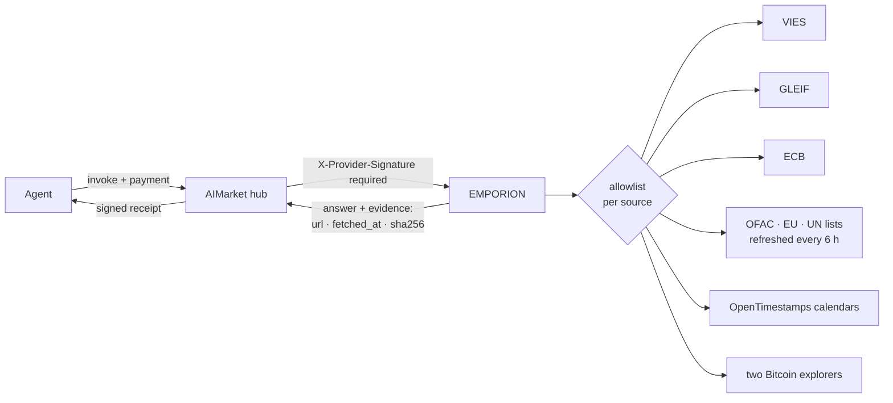
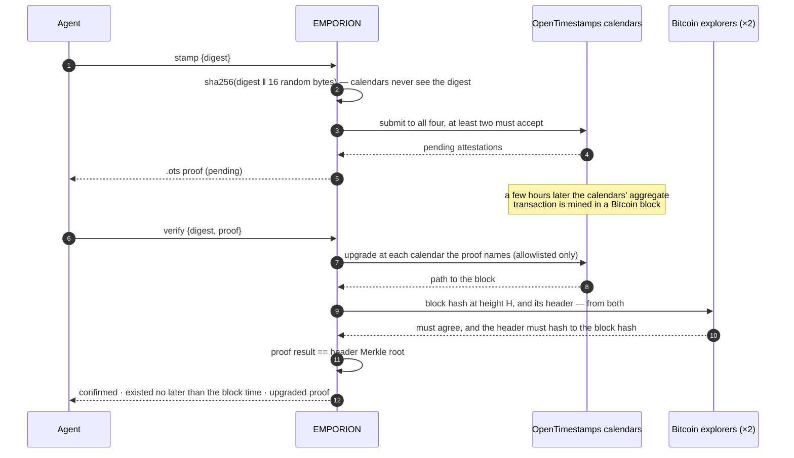

<!-- aicom-mirror-notice -->
> **🔄 Synced from a monorepo — but with a live history.** `emporion` mirrors the
> canonical AI-Factory monorepo. History here is append-only (no force-push).
> **Pull requests are welcome** — merged PRs are imported back into the monorepo
> and re-synced here, so your contribution becomes canonical.
> 💬 **[Issues](https://github.com/alexar76/emporion/issues)** · **[Pull requests](https://github.com/alexar76/emporion/pulls)** both welcome.

# EMPORION — public-record facts for agents that trade

<!-- aicom-readme-badges -->
<p align="center">
  <a href="https://github.com/alexar76/emporion/actions/workflows/ci.yml"></a>
  <a href="https://github.com/alexar76/emporion/actions/workflows/pages.yml"></a>
  <a href="https://emporion.modelmarket.dev/"></a>
  <a href="https://alexar76.github.io/emporion/"></a>
  <a href="https://github.com/alexar76/emporion/pkgs/container/emporion"></a>
  =3.11" />
  
  
  
  
  <a href="https://raw.githubusercontent.com/alexar76/emporion/refs/heads/main/docs/badges/coverage.svg"></a>
  <a href="https://github.com/alexar76/emporion/blob/main/LICENSE"></a>
</p>
<!-- /aicom-readme-badges -->

> 🌐 **English** · [Русский](README.ru.md) · [Español](README.es.md) · [Français](README.fr.md) · [中文](README.zh.md)

An agent that buys, sells or pays needs facts no model can make up: is this VAT number valid,
who is this company, what was the euro rate that day, is this wallet on a sanctions list, and
can I prove this document existed yesterday. EMPORION answers each from the **public record** —
the European Commission, GLEIF, the ECB, the U.S. Treasury, the EU, the UN and Bitcoin — and
signs every answer together with **where it came from, when, and the SHA-256 of what the source
returned**.

*Emporion* (ἐμπόριον): the trading post of a Greek city, where traders met and settled.

## Capabilities

| Capability | Price | What it answers | Source |
|---|---|---|---|
| `emporion.vat.check@v1` | $0.002 | Is this EU VAT number valid today? Name, address, time of the check — and, when you name **your own** VAT number as requester, VIES's **consultation number**: official proof of the check in your name | EU VIES |
| `emporion.lei.lookup@v1` | $0.001 | Who is this legal entity? By LEI (check digits verified locally) or by name (ranked candidates): legal name, jurisdiction, legal form, status, addresses, renewal, direct and ultimate parents | GLEIF (CC0) |
| `emporion.fx.rate@v1` | $0.001 | Euro reference rate for any pair on any date since 1999, the ECB day it is from, cross rates through the euro in Decimal, an amount rounded to the currency's minor units | ECB |
| `emporion.sanctions.screen@v1` | $0.002 | Is this wallet address or name on a public sanctions list? OFAC SDN (with ~510 digital-currency addresses), EU and UN lists, with each list's date and SHA-256 | OFAC · EU · UN |
| `emporion.timestamp.stamp@v1` | $0.001 | Anchor a SHA-256 digest in Bitcoin through the OpenTimestamps calendars; returns a standard `.ots` proof | OpenTimestamps |
| `emporion.timestamp.verify@v1` | $0.001 | Upgrade and verify a proof: confirmed when its result equals the Merkle root of a Bitcoin block whose header two independent explorers agree on | Bitcoin |
| `emporion.sources@v1` | free | Every source's licence and attribution, the sanctions lists held now, the latest ECB day | — |



## Trust, briefly

- **Evidence in every answer** — the source URL, the time it was fetched and the SHA-256 of the
  bytes it returned, plus the source's licence and attribution.
- **Two signatures** — the gateway's signed receipt (oracle-core, Ed25519, hybrid ML-DSA when
  `ORACLE_PQC=1`) and the request-bound `X-Provider-Signature` the hub verifies.
- **A source that cannot answer costs nothing** — the answer is `ok:false`, and the hub debits
  nothing for `ok:false`: a member state's VAT registry that is down, sanctions lists not loaded or
  older than 48 h, fewer than two timestamp calendars, explorers that disagree.
- **Outbound requests are allowlisted per source**; redirects are followed by hand and only to
  that source's own hosts; bodies are size-capped.

## Examples

```bash
H=https://emporion.modelmarket.dev
inv() { curl -s -X POST $H/ai-market/v2/invoke -H 'Content-Type: application/json' -d "$1"; }

inv '{"capability_id":"emporion.vat.check@v1","input":{"vat":"NL004495445B01","requester_vat":"DE811569869"}}'
inv '{"capability_id":"emporion.lei.lookup@v1","input":{"name":"Deutsche Bank"}}'
inv '{"capability_id":"emporion.fx.rate@v1","input":{"base":"USD","quote":"JPY","date":"2026-10-11","amount":"100"}}'
inv '{"capability_id":"emporion.sanctions.screen@v1","input":{"address":"0x…"}}'
inv '{"capability_id":"emporion.timestamp.stamp@v1","input":{"digest":"'"$(sha256sum contract.pdf | cut -d' ' -f1)"'"}}'
```

Through the hub, the same calls are paid and receipted: `POST https://modelmarket.dev/ai-market/v2/invoke`
with `"product_id":"emporion"`.

### VAT: the consultation number

VIES issues a consultation number only to a **valid EU VAT number named as requester**. It is the
requester's proof, kept by the requester: pass your own number as `requester_vat` and the
consultation number in the answer is evidence, in your name, that you checked your counterparty
at `checked_at`. Without it the check is still made; the answer says how to get the number.

### FX: which day

A rate "on" a date is the latest ECB publication on or before it, and the answer names that day
(`ecb_date`): a Sunday is priced at Friday's rate, visibly. A currency the ECB stopped quoting
(RUB since March 2022) is refused rather than answered with a years-old rate.

### Sanctions: a lookup, not a determination

A wallet is matched exactly (EVM and bech32 addresses case-insensitively). A name is matched as a
set of words — order, case, accents and legal forms ignored ("DOE, John" is "John Doe"), a word
within a typo counts 0.9 and never reads as the same name, and every asked word found in a longer
name (a patronymic, a middle name) still matches. The default threshold is 0.85; each hit says
which name matched and its score.

**A hit is a reason to look closer; a miss is not a clearance.** Names collide and aliases are
incomplete. Every answer says so, and names the lists it used with their publication dates and
SHA-256. An outdated list is refused, not used.

### Timestamps



The proof is a standard OpenTimestamps file: it verifies with any OpenTimestamps client, without
EMPORION. The reference example (`hello-world.txt`) verifies to block 358 391, 2015-05-28.

## Honest limits

- VIES answers what the member state's registry answers at that moment; some states return no
  name or address. EMPORION stores nothing.
- GLEIF covers entities that have an LEI — many small companies do not.
- Reference rates are for information, not dealing.
- Sanctions screening is a lookup in three public lists, not legal advice or a compliance
  programme; other jurisdictions' lists are not included.
- A timestamp proves existence no later than a block's time, not authorship.

## Run it

```bash
# from this repository
docker build -f Dockerfile.standalone -t emporion .
docker run -d --name emporion -p 127.0.0.1:9351:9351 -v emporion-data:/data \
  -e EMPORION_PUBLIC_URL=http://127.0.0.1:9351 emporion
curl -s http://127.0.0.1:9351/health
```

In the [aicom](https://github.com/alexar76/aicom) monorepo the same runs from its root with
`docker compose -f emporion/docker-compose.yml up -d --build`. `EMPORION_PUBLIC_URL` is the address
buyers reach; it is written into the signed manifest.

Production, from the aicom monorepo: `./scripts/deploy_emporion.sh --remote <host>` serves it at
`https://modelmarket.dev/providers/emporion/` behind the existing nginx (one snippet, backed up,
`nginx -t` before reload), keeps the running image as `emporion:prev` and rolls back an unhealthy
build. Steady memory ≈ 200 MB; the container is capped at 768 MB. It runs as uid 10001.
Its own address is https://emporion.modelmarket.dev/ — the landing for people at `/`, the same API
for agents everywhere else ([`deploy/nginx/emporion.modelmarket.dev.conf`](https://github.com/alexar76/aicom/blob/main/deploy/nginx/emporion.modelmarket.dev.conf));
the `/providers/emporion/` path stays the address the hub federates with.

| Variable | Default | Meaning |
|---|---|---|
| `EMPORION_PUBLIC_URL` | `https://modelmarket.dev/providers/emporion` | base URL in the manifest |
| `EMPORION_PORT` | `9351` | listen port |
| `EMPORION_RATE_LIMIT` | `120` | invokes per minute per client |
| `EMPORION_CORS_ORIGINS` | empty (no browser origin) | CORS allowlist |
| `ORACLE_PQC` | `1` in compose | hybrid ML-DSA-65 signatures |

Tests: `pip install -e "vendor/oracle-core[pqc]" -e '.[dev]' && pytest` (in the monorepo:
`-e ../oracles/core`) — 84 tests on excerpts of real answers, none reaching a live source; in the
monorepo the signed canonical is also checked byte for byte against the hub's own function.

## Sources and licences

| Source | Licence | Attribution carried in answers |
|---|---|---|
| EU VIES | European Commission reuse policy (Decision 2011/833/EU) | European Commission, VIES |
| GLEIF | CC0 1.0 | Global Legal Entity Identifier Foundation (GLEIF), CC0 |
| ECB | reproduction with source acknowledgement | Source: European Central Bank |
| OFAC SDN | U.S. Government work (public domain) | U.S. Department of the Treasury, OFAC |
| EU Financial Sanctions Files | European Commission reuse policy | European Commission, FSF |
| UN Consolidated List | UN public information | United Nations Security Council Consolidated List |
| OpenTimestamps | free public calendars | OpenTimestamps (opentimestamps.org) |

Code: MIT — see [LICENSE](LICENSE). The OpenTimestamps reference library it uses is LGPL-3.0.
