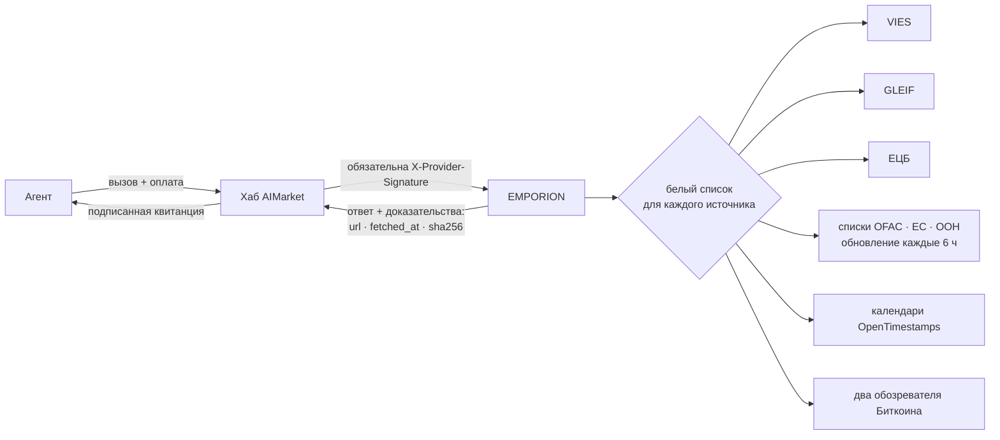
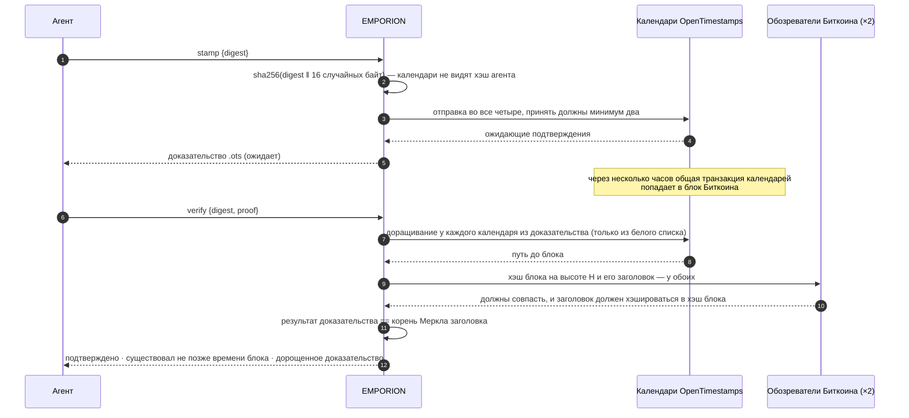

# EMPORION — публичные факты для агентов, которые торгуют

<!-- aicom-readme-badges -->
<p align="center">
  <a href="https://github.com/alexar76/emporion/actions/workflows/ci.yml"></a>
  <a href="https://github.com/alexar76/emporion/actions/workflows/pages.yml"></a>
  <a href="https://emporion.modelmarket.dev/"></a>
  <a href="https://alexar76.github.io/emporion/"></a>
  <a href="https://github.com/alexar76/emporion/pkgs/container/emporion"></a>
  =3.11" />
  
  
  
  
  <a href="https://raw.githubusercontent.com/alexar76/emporion/refs/heads/main/docs/badges/coverage.svg"></a>
  <a href="https://github.com/alexar76/emporion/blob/main/LICENSE"></a>
</p>
<!-- /aicom-readme-badges -->

> 🌐 [English](README.md) · **Русский** · [Español](README.es.md) · [Français](README.fr.md) · [中文](README.zh.md)

Агенту, который покупает, продаёт или платит, нужны факты, которые никакая модель не выдумает:
действителен ли этот НДС-номер, кто эта компания, какой был курс евро в тот день, нет ли этого
кошелька в санкционном списке, могу ли я доказать, что документ существовал вчера. EMPORION
отвечает на каждый вопрос из **публичных реестров** — Еврокомиссия, GLEIF, ЕЦБ, Минфин США, ЕС,
ООН и Биткоин — и подписывает каждый ответ вместе с тем, **откуда он, когда получен и SHA-256
того, что вернул источник**.

*Эмпорион* (ἐμπόριον) — торговое место греческого города, где купцы встречались и рассчитывались.

## Функции

| Функция | Цена | На что отвечает | Источник |
|---|---|---|---|
| `emporion.vat.check@v1` | $0.002 | Действителен ли этот НДС-номер ЕС сегодня? Название, адрес, время проверки — а если указать **свой** НДС-номер как запрашивающего, **номер консультации** VIES: официальное доказательство проверки на ваше имя | EU VIES |
| `emporion.lei.lookup@v1` | $0.001 | Кто это юрлицо? По LEI (контрольные цифры проверяются локально) или по названию (ранжированные кандидаты): юридическое название, юрисдикция, правовая форма, статус, адреса, продление, прямой и конечный владелец | GLEIF (CC0) |
| `emporion.fx.rate@v1` | $0.001 | Справочный курс евро для любой пары на любую дату с 1999 года, день ЕЦБ, к которому он относится, кросс-курсы через евро в Decimal, сумма с округлением до минорных единиц валюты | ЕЦБ |
| `emporion.sanctions.screen@v1` | $0.002 | Есть ли этот адрес кошелька или имя в публичном санкционном списке? OFAC SDN (около 510 адресов цифровых валют), списки ЕС и ООН, с датой и SHA-256 каждого списка | OFAC · ЕС · ООН |
| `emporion.timestamp.stamp@v1` | $0.001 | Привязать хэш SHA-256 к Биткоину через календари OpenTimestamps; возвращает стандартное доказательство `.ots` | OpenTimestamps |
| `emporion.timestamp.verify@v1` | $0.001 | Дорастить и проверить доказательство: подтверждено, когда его результат равен корню Меркла блока Биткоина, заголовок которого совпадает у двух независимых обозревателей | Биткоин |
| `emporion.sources@v1` | бесплатно | Лицензия и атрибуция каждого источника, санкционные списки, которые хранятся сейчас, последний день ЕЦБ | — |



## Доверие — коротко

- **Доказательства в каждом ответе** — адрес источника, время получения и SHA-256 полученных
  байтов, плюс лицензия и атрибуция источника.
- **Две подписи** — подписанная квитанция шлюза (oracle-core, Ed25519, гибридная ML-DSA при
  `ORACLE_PQC=1`) и привязанная к запросу `X-Provider-Signature`, которую проверяет хаб.
- **Источник, который не может ответить, ничего не стоит** — ответ `ok:false`, а за `ok:false`
  хаб ничего не списывает: недоступный реестр НДС страны, санкционные списки не загружены или
  старше 48 ч, меньше двух календарей меток времени, обозреватели не согласны.
- **Исходящие запросы — по белому списку для каждого источника**; переадресации проверяются
  вручную и только на хосты того же источника; размер ответа ограничен.

## Примеры

```bash
H=https://emporion.modelmarket.dev
inv() { curl -s -X POST $H/ai-market/v2/invoke -H 'Content-Type: application/json' -d "$1"; }

inv '{"capability_id":"emporion.vat.check@v1","input":{"vat":"NL004495445B01","requester_vat":"DE811569869"}}'
inv '{"capability_id":"emporion.lei.lookup@v1","input":{"name":"Deutsche Bank"}}'
inv '{"capability_id":"emporion.fx.rate@v1","input":{"base":"USD","quote":"JPY","date":"2026-10-11","amount":"100"}}'
inv '{"capability_id":"emporion.sanctions.screen@v1","input":{"address":"0x…"}}'
inv '{"capability_id":"emporion.timestamp.stamp@v1","input":{"digest":"'"$(sha256sum contract.pdf | cut -d' ' -f1)"'"}}'
```

Через хаб те же вызовы оплачиваются и получают квитанции:
`POST https://modelmarket.dev/ai-market/v2/invoke` с `"product_id":"emporion"`.

### НДС: номер консультации

VIES выдаёт номер консультации только **действительному НДС-номеру ЕС, указанному как
запрашивающий**. Это доказательство запрашивающего, и хранит его запрашивающий: передайте свой
номер в `requester_vat` — и номер консультации в ответе станет доказательством на ваше имя, что
вы проверили контрагента в момент `checked_at`. Без него проверка всё равно выполняется, а ответ
подсказывает, как получить номер.

### Курсы: какой день

Курс «на дату» — последняя публикация ЕЦБ не позже этой даты, и ответ называет этот день
(`ecb_date`): воскресенье считается по пятничному курсу, и это видно. Валюту, которую ЕЦБ перестал
котировать (рубль с марта 2022), EMPORION отклоняет, а не отвечает курсом многолетней давности.

### Санкции: поиск, а не вывод

Кошелёк сравнивается точно (адреса EVM и bech32 — без учёта регистра). Имя сравнивается как набор
слов — порядок, регистр, диакритика и правовые формы не важны («DOE, John» — это «John Doe»);
слово с опечаткой весит 0,9 и никогда не считается тем же именем; если все слова запроса есть в
более длинном имени (отчество, второе имя), это тоже совпадение. Порог по умолчанию 0,85; каждое
совпадение указывает, какое имя совпало, и его оценку.

**Совпадение — повод присмотреться; отсутствие совпадения — не разрешение.** Имена совпадают у
разных людей, псевдонимы неполны. Каждый ответ говорит об этом и называет использованные списки
с датами публикации и SHA-256. Устаревший список отклоняется, а не используется.

### Метки времени



Доказательство — стандартный файл OpenTimestamps: он проверяется любым клиентом OpenTimestamps
без EMPORION. Эталонный пример (`hello-world.txt`) проверяется до блока 358 391, 28.05.2015.

## Честные ограничения

- VIES отвечает то, что в этот момент отвечает реестр страны; некоторые страны не отдают название
  и адрес. EMPORION ничего не хранит.
- GLEIF покрывает юрлица, у которых есть LEI, — у многих малых компаний его нет.
- Справочные курсы — для информации, а не для сделок.
- Санкционная проверка — это поиск по трём публичным спискам, а не юридическая консультация и не
  программа комплаенса; списки других юрисдикций не включены.
- Метка времени доказывает существование не позже времени блока, а не авторство.

## Запуск

```bash
# из этого репозитория
docker build -f Dockerfile.standalone -t emporion .
docker run -d --name emporion -p 127.0.0.1:9351:9351 -v emporion-data:/data \
  -e EMPORION_PUBLIC_URL=http://127.0.0.1:9351 emporion
curl -s http://127.0.0.1:9351/health
```

В монорепозитории [aicom](https://github.com/alexar76/aicom) то же самое запускается из его корня:
`docker compose -f emporion/docker-compose.yml up -d --build`. `EMPORION_PUBLIC_URL` — адрес, по
которому до сервиса доходят покупатели; он записывается в подписанный манифест.

Прод, из монорепозитория aicom: `./scripts/deploy_emporion.sh --remote <хост>` публикует его по адресу
`https://modelmarket.dev/providers/emporion/` за существующим nginx (один сниппет с резервной
копией и `nginx -t` перед перезагрузкой), сохраняет работающий образ как `emporion:prev` и
откатывает нездоровую сборку. Память в покое ≈ 200 МБ, предел контейнера 768 МБ. Процесс работает
под uid 10001. Собственный адрес — https://emporion.modelmarket.dev/: для людей по `/` лендинг, для
агентов по всем остальным путям тот же API ([`deploy/nginx/emporion.modelmarket.dev.conf`](https://github.com/alexar76/aicom/blob/main/deploy/nginx/emporion.modelmarket.dev.conf));
путь `/providers/emporion/` остаётся адресом, под которым EMPORION знает федерация хабов.

| Переменная | По умолчанию | Смысл |
|---|---|---|
| `EMPORION_PUBLIC_URL` | `https://modelmarket.dev/providers/emporion` | базовый адрес в манифесте |
| `EMPORION_PORT` | `9351` | порт |
| `EMPORION_RATE_LIMIT` | `120` | вызовов в минуту на клиента |
| `EMPORION_CORS_ORIGINS` | пусто (браузерам нельзя) | список разрешённых источников CORS |
| `ORACLE_PQC` | `1` в compose | гибридные подписи ML-DSA-65 |

Тесты: `pip install -e "vendor/oracle-core[pqc]" -e '.[dev]' && pytest` (в монорепозитории:
`-e ../oracles/core`) — 84 теста на фрагментах настоящих ответов, ни один не ходит к живым
источникам; в монорепозитории подписываемая каноническая строка ещё и побайтно сверяется с
функцией самого хаба.

## Источники и лицензии

| Источник | Лицензия | Атрибуция в ответах |
|---|---|---|
| EU VIES | политика повторного использования Еврокомиссии (Решение 2011/833/EU) | European Commission, VIES |
| GLEIF | CC0 1.0 | Global Legal Entity Identifier Foundation (GLEIF), CC0 |
| ЕЦБ | воспроизведение со ссылкой на источник | Source: European Central Bank |
| OFAC SDN | работа правительства США (общественное достояние) | U.S. Department of the Treasury, OFAC |
| Санкционные файлы ЕС (FSF) | политика повторного использования Еврокомиссии | European Commission, FSF |
| Сводный список ООН | публичная информация ООН | United Nations Security Council Consolidated List |
| OpenTimestamps | бесплатные публичные календари | OpenTimestamps (opentimestamps.org) |

Код: MIT — см. [LICENSE](LICENSE). Используемая эталонная библиотека OpenTimestamps — LGPL-3.0.
