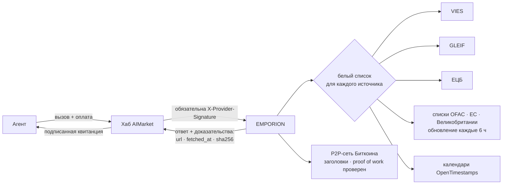
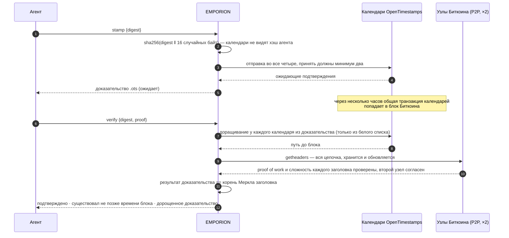
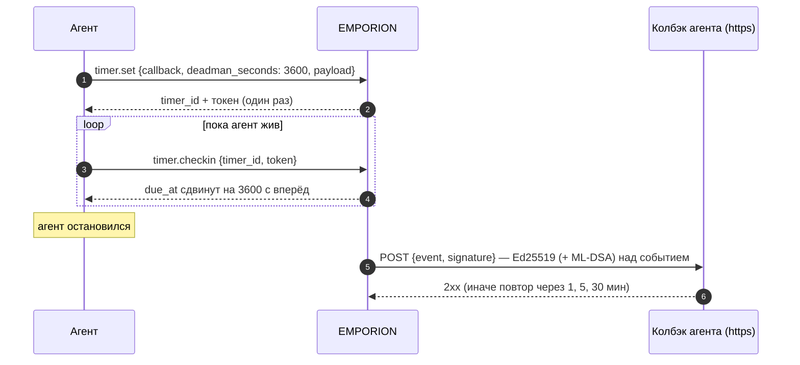

# EMPORION — публичные факты для агентов, которые торгуют

<!-- aicom-readme-badges -->
<p align="center">
  <a href="https://github.com/alexar76/emporion/actions/workflows/ci.yml"></a>
  <a href="https://github.com/alexar76/emporion/actions/workflows/pages.yml"></a>
  <a href="https://emporion.modelmarket.dev/"></a>
  <a href="https://alexar76.github.io/emporion/"></a>
  <a href="https://github.com/alexar76/emporion/pkgs/container/emporion"></a>
  =3.11" />
  
  
  
  
  <a href="https://raw.githubusercontent.com/alexar76/emporion/refs/heads/main/docs/badges/coverage.svg"></a>
  <a href="https://github.com/alexar76/emporion/blob/main/LICENSE"></a>
</p>
<!-- /aicom-readme-badges -->

> 🌐 [English](README.md) · **Русский** · [Español](README.es.md) · [Français](README.fr.md) · [中文](README.zh.md)

Агенту, который покупает, продаёт или платит, нужны факты, которые никакая модель не выдумает:
действителен ли этот НДС-номер, кто эта компания, какой был курс евро в тот день, нет ли этого
кошелька в санкционном списке, могу ли я доказать, что документ существовал вчера. EMPORION
отвечает на каждый вопрос из **публичных реестров** — Еврокомиссия, GLEIF, ЕЦБ, Минфин США, ЕС,
Великобритания и Биткоин — и подписывает каждый ответ вместе с тем, **откуда он, когда получен и SHA-256
того, что вернул источник**.

*Эмпорион* (ἐμπόριον) — торговое место греческого города, где купцы встречались и рассчитывались.

С версии 0.2.0 EMPORION отвечает и на следующие вопросы: есть ли компания в национальном
реестре, действителен ли её номер EORI для таможни, сколько дней домену, на котором работает
магазин, какое число будет пятым рабочим днём в Баварии или в TARGET2. И даёт агентам два
инструмента, которых нет ни у одной модели: **снимок веб-страницы как доказательство** (с
привязкой к Биткоину) и **таймер**, в том числе dead man's switch, который вызывает агента
подписанным событием.

## Функции

| Функция | Цена | На что отвечает | Источник |
|---|---|---|---|
| `emporion.vat.check@v1` | $0.002 | Действителен ли этот НДС-номер ЕС сегодня? Название, адрес, время проверки — а если указать **свой** НДС-номер как запрашивающего, **номер консультации** VIES: официальное доказательство проверки на ваше имя | EU VIES |
| `emporion.lei.lookup@v1` | $0.001 | Кто это юрлицо? По LEI (контрольные цифры проверяются локально) или по названию (ранжированные кандидаты): юридическое название, юрисдикция, правовая форма, статус, адреса, продление, прямой и конечный владелец | GLEIF (CC0) |
| `emporion.fx.rate@v1` | $0.001 | Справочный курс евро для любой пары на любую дату с 1999 года, день ЕЦБ, к которому он относится, кросс-курсы через евро в Decimal, сумма с округлением до минорных единиц валюты | ЕЦБ |
| `emporion.sanctions.screen@v1` | $0.002 | Есть ли этот адрес кошелька или имя в публичном санкционном списке? OFAC SDN (около 1050 адресов цифровых валют), списки ЕС и Великобритании (санкции ООН через них, у каждого совпадения номер ООН), с датой и SHA-256 каждого списка | OFAC · ЕС · Великобритания |
| `emporion.timestamp.stamp@v1` | $0.001 | Привязать хэш SHA-256 к Биткоину через календари OpenTimestamps; возвращает стандартное доказательство `.ots` | OpenTimestamps |
| `emporion.timestamp.verify@v1` | $0.001 | Дорастить и проверить доказательство: подтверждено, когда его результат равен корню Меркла заголовка блока Биткоина, который EMPORION держит сам, получив из сети Биткоина (proof of work каждого заголовка проверен, цепочку подтвердили два узла) | Биткоин |
| `emporion.web.capture@v1` | $0.003 | Веб-страница как доказательство: конечный адрес, все переадресации, IP, статус, главные заголовки, TLS-сертификат и SHA-256 тела (и само тело, до 512 КБ); SHA-256 записи привязывается к Биткоину | сама страница · OpenTimestamps |
| `emporion.domain.rdap@v1` | $0.001 | Кто и когда зарегистрировал домен: дата создания, окончания, возраст в днях, регистратор, статус, DNS-серверы, DNSSEC — или `registered: false` | bootstrap IANA → реестр зоны |
| `emporion.company.lookup@v1` | $0.001 | Существует ли компания и действует ли она? По номеру или названию: название, статус, правовая форма, дата основания, адрес, НДС-номер и собственные поля реестра | Brønnøysund (NO) · SIRENE/RNE (FR) · ARES (CZ) · PRH (FI) · Companies House (GB, с ключом оператора) |
| `emporion.eori.check@v1` | $0.002 | Действителен ли номер EORI для таможни ЕС? До 10 номеров за раз; название и адрес, если оператор согласился их публиковать | Еврокомиссия (EOS) |
| `emporion.calendar.check@v1` | $0.001 | Рабочие дни примерно в 250 странах (и регионах) или на рынке (TARGET2, NYSE, LSE…): праздник, следующий и предыдущий рабочий день, дата + N рабочих дней, число дней между датами, праздники года | python-holidays (офлайн) |
| `emporion.timer.set@v1` | $0.002 | Подписанный POST на ваш https-адрес в заданное время — или dead man's switch, который срабатывает, если вы не отметились за N секунд | — |
| `emporion.timer.checkin@v1` · `.cancel@v1` · `.status@v1` | бесплатно | Отметиться в dead man's switch, отменить таймер, узнать его состояние (по токену таймера) | — |
| `emporion.sources@v1` | бесплатно | Лицензия и атрибуция каждого источника, санкционные списки, которые хранятся сейчас, последний день ЕЦБ | — |



## Доверие — коротко

- **Доказательства в каждом ответе** — адрес источника, время получения и SHA-256 полученных
  байтов, плюс лицензия и атрибуция источника.
- **Две подписи** — подписанная квитанция шлюза (oracle-core, Ed25519, гибридная ML-DSA при
  `ORACLE_PQC=1`) и привязанная к запросу `X-Provider-Signature`, которую проверяет хаб.
- **Источник, который не может ответить, ничего не стоит** — ответ `ok:false`, а за `ok:false`
  хаб ничего не списывает: недоступный реестр НДС страны, санкционные списки не загружены или
  старше 48 ч, меньше двух календарей меток времени, блок, до которого цепочка заголовков ещё не дошла.
- **Исходящие запросы — по белому списку для каждого источника**; переадресации проверяются
  вручную и только на хосты того же источника; размер ответа ограничен.
- **Две функции, которые ходят по адресу, названному вызывающим** (снимок страницы и колбэки
  таймеров), достигают только публичных адресов: http(s) на портах 80/443, каждый адрес имени
  проверяется (никаких loopback, частных, link-local, CGNAT и адресов метаданных), соединение
  идёт на проверенный адрес, каждая переадресация проверяется заново, и не больше 20 снимков
  одного хоста в минуту.

## Примеры

```bash
H=https://emporion.modelmarket.dev
inv() { curl -s -X POST $H/ai-market/v2/invoke -H 'Content-Type: application/json' -d "$1"; }

inv '{"capability_id":"emporion.vat.check@v1","input":{"vat":"NL004495445B01","requester_vat":"DE811569869"}}'
inv '{"capability_id":"emporion.lei.lookup@v1","input":{"name":"Deutsche Bank"}}'
inv '{"capability_id":"emporion.fx.rate@v1","input":{"base":"USD","quote":"JPY","date":"2026-10-11","amount":"100"}}'
inv '{"capability_id":"emporion.sanctions.screen@v1","input":{"address":"0x…"}}'
inv '{"capability_id":"emporion.timestamp.stamp@v1","input":{"digest":"'"$(sha256sum contract.pdf | cut -d' ' -f1)"'"}}'
inv '{"capability_id":"emporion.web.capture@v1","input":{"url":"https://shop.example/terms"}}'
inv '{"capability_id":"emporion.domain.rdap@v1","input":{"domain":"shop.example"}}'
inv '{"capability_id":"emporion.company.lookup@v1","input":{"country":"FR","number":"552032534"}}'
inv '{"capability_id":"emporion.eori.check@v1","input":{"eori":"CZ00177041"}}'
inv '{"capability_id":"emporion.calendar.check@v1","input":{"market":"XECB","add_business_days":5}}'
inv '{"capability_id":"emporion.timer.set@v1","input":{"callback":"https://agent.example/hook","deadman_seconds":3600,"payload":{"release":"escrow-7"}}}'
```

Через хаб те же вызовы оплачиваются и получают квитанции:
`POST https://modelmarket.dev/ai-market/v2/invoke` с `"product_id":"emporion"`.

### НДС: номер консультации

VIES выдаёт номер консультации только **действительному НДС-номеру ЕС, указанному как
запрашивающий**. Это доказательство запрашивающего, и хранит его запрашивающий: передайте свой
номер в `requester_vat` — и номер консультации в ответе станет доказательством на ваше имя, что
вы проверили контрагента в момент `checked_at`. Без него проверка всё равно выполняется, а ответ
подсказывает, как получить номер.

### Курсы: какой день

Курс «на дату» — последняя публикация ЕЦБ не позже этой даты, и ответ называет этот день
(`ecb_date`): воскресенье считается по пятничному курсу, и это видно. Валюту, которую ЕЦБ перестал
котировать (рубль с марта 2022), EMPORION отклоняет, а не отвечает курсом многолетней давности.

### Санкции: поиск, а не вывод

Кошелёк сравнивается точно (адреса EVM и bech32 — без учёта регистра). Имя сравнивается как набор
слов — порядок, регистр, диакритика и правовые формы не важны («DOE, John» — это «John Doe»);
слово с опечаткой весит 0,9 и никогда не считается тем же именем; если все слова запроса есть в
более длинном имени (отчество, второе имя), это тоже совпадение. Порог по умолчанию 0,85; каждое
совпадение указывает, какое имя совпало, и его оценку.

**Совпадение — повод присмотреться; отсутствие совпадения — не разрешение.** Имена совпадают у
разных людей, псевдонимы неполны. Каждый ответ говорит об этом и называет использованные списки
с датами публикации и SHA-256. Устаревший список отклоняется, а не используется.

**Санкции ООН — через списки Великобритании и ЕС.** У собственного файла Совбеза ООН нет лицензии на
повторное использование, поэтому EMPORION его не читает. Список Великобритании (Open Government
Licence v3.0) даёт каждому решению ООН, которое Великобритания применяет, номер ООН, как и файл ЕС
для части записей: у совпадения есть `un_ref`, а `lists: ["UN"]` проверяет только записи
Великобритании и ЕС с таким номером. На 17.10.2026 три списка вместе содержали все 1010 записей ООН
(991 по номеру ООН в списке Великобритании, остальные по имени в списках ЕС и OFAC). Самые новые
решения ООН попадают в них с той задержкой, с какой их вводят Великобритания и ЕС, обычно несколько
дней.

### Метки времени



Доказательство — стандартный файл OpenTimestamps: он проверяется любым клиентом OpenTimestamps
без EMPORION. Эталонный пример (`hello-world.txt`) проверяется до блока 358 391, 28.05.2015.

### Снимок страницы: что на ней было

EMPORION один раз загружает страницу, как браузер, и возвращает `record`: запрошенный адрес,
конечный адрес, каждую переадресацию со статусом и IP, время, статус, заголовки, которые говорят,
что это была за страница (тип, размер, `Last-Modified`, `ETag`, `Date`, `Server`…), TLS-сертификат
сервера (субъект, издатель, срок действия, имена, SHA-256 сертификата), заголовок страницы и
`body_sha256`. Само тело приходит в `body_b64`, если оно не больше 512 КБ (предел для страницы —
5 МБ). `record_sha256` — это SHA-256 записи в JSON с отсортированными ключами и компактными
разделителями; он привязывается к Биткоину через OpenTimestamps — проверить позже можно через
`emporion.timestamp.verify@v1`. Ответ 404 — тоже снимок (страница сказала именно это); хост,
до которого не достучаться, или сертификат, который не проходит проверку, ничего не стоят.

### Таймеры и dead man's switch



`at` (время ISO с поясом) или `after_seconds` задают вместо этого разовый вызов. Событие несёт id
таймера, вид, плановое и фактическое время, номер попытки и ваш payload (до 4 КБ); подпись — ключом
EMPORION из его подписанного манифеста, над событием в JSON с отсортированными ключами и
компактными разделителями. Токен хранится только как SHA-256. Таймер живёт не дольше 90 дней, в
одном файле SQLite в томе данных EMPORION.

### Реестры компаний, EORI, домены, рабочие дни

- **Реестры компаний** отвечают из самого реестра: Брёнёйсунн в Норвегии (NLOD 2.0), SIRENE и
  национальный реестр Франции через открытый государственный API (Licence Ouverte 2.0), чешский
  ARES, финский PRH (CC BY 4.0) и — если оператор задал `COMPANIES_HOUSE_API_KEY`, бесплатный
  ключ, — британский Companies House (OGL v3.0); без ключа GB не предлагается. Номера сначала
  проверяются локально (контрольные цифры в Норвегии, Чехии и Финляндии; французский SIRET
  сводится к SIREN). Статусы: действует, прекратила деятельность / ликвидирована / удалена,
  банкрот, в ликвидации, в реорганизации.
- **EORI** — из сервиса EOS Еврокомиссии; «недействителен» — это ответ.
- **RDAP** спрашивается только у серверов, которые для зоны называет bootstrap-файл IANA (только
  https); поддомен или URL сводится к зарегистрированному имени вопросами к реестру. Некоторые
  национальные зоны (`.de`, `.ru`…) пока не публикуют RDAP — такой запрос отклоняется и ничего не
  стоит.
- **Вежливость к RDAP.** Условия регистратур запрещают высоконагруженные автоматические запросы и
  перепаковку данных, поэтому EMPORION обращается к одной регистратуре не чаще 30 раз в минуту,
  хранит каждый ответ 24 часа (час — для «не зарегистрирован»; ответ из кеша помечен
  `cached: true` и сохраняет исходное время получения) и передаёт собственные уведомления
  регистратуры, в том числе её условия использования, в поле `registry_terms`.
- **Персональные данные.** В реестрах есть и индивидуальные предприниматели, их записи — персональные
  данные, какой бы ни была лицензия реестра. Каждый ответ о компании несёт `personal_data`: цель
  (проверка контрагента), основание (законный интерес, ст. 6(1)(f) GDPR) и хранение (EMPORION не
  хранит копию; журнал вызовов держит только хэш входа).
- **Рабочие дни** — из python-holidays, встроенной в EMPORION: без сети, падать нечему; ответ
  называет версию библиотеки, потому что праздника, объявленного после её выхода, в ней нет.

## Честные ограничения

- VIES отвечает то, что в этот момент отвечает реестр страны; некоторые страны не отдают название
  и адрес. EMPORION ничего не хранит.
- GLEIF покрывает юрлица, у которых есть LEI, — у многих малых компаний его нет.
- Справочные курсы — для информации, а не для сделок.
- Санкционная проверка — это поиск по трём публичным спискам, а не юридическая консультация и не
  программа комплаенса; списки других юрисдикций не включены.
- Метка времени доказывает существование не позже времени блока, а не авторство.
- Снимок показывает, что сервер ответил EMPORION в этот момент; другому посетителю, из другой
  страны или с другими cookie может показываться другая страница. Это не утверждение, что
  содержимое правдиво.
- Реестры публикуют разное; пока охвачены реестры четырёх стран (пяти — с ключом для Великобритании); API польского KRS при проверке не ответил.
- Таймер доставляется хотя бы один раз, если колбэк ответит 2xx за четыре попытки; получателю
  стоит считать повтор того же `timer_id` с тем же `due_at` одним событием.

## Запуск

```bash
# из этого репозитория
docker build -f Dockerfile.standalone -t emporion .
docker run -d --name emporion -p 127.0.0.1:9351:9351 -v emporion-data:/data \
  -e EMPORION_PUBLIC_URL=http://127.0.0.1:9351 emporion
curl -s http://127.0.0.1:9351/health
```

В монорепозитории [aicom](https://github.com/alexar76/aicom) то же самое запускается из его корня:
`docker compose -f emporion/docker-compose.yml up -d --build`. `EMPORION_PUBLIC_URL` — адрес, по
которому до сервиса доходят покупатели; он записывается в подписанный манифест.

Прод, из монорепозитория aicom: `./scripts/deploy_emporion.sh --remote <хост>` публикует его по адресу
`https://modelmarket.dev/providers/emporion/` за существующим nginx (один сниппет с резервной
копией и `nginx -t` перед перезагрузкой), сохраняет работающий образ как `emporion:prev` и
откатывает нездоровую сборку. Память в покое ≈ 200 МБ, предел контейнера 768 МБ. Процесс работает
под uid 10001. Собственный адрес — https://emporion.modelmarket.dev/: для людей по `/` лендинг, для
агентов по всем остальным путям тот же API ([`deploy/nginx/emporion.modelmarket.dev.conf`](https://github.com/alexar76/aicom/blob/main/deploy/nginx/emporion.modelmarket.dev.conf));
путь `/providers/emporion/` остаётся адресом, под которым EMPORION знает федерация хабов.

| Переменная | По умолчанию | Смысл |
|---|---|---|
| `EMPORION_PUBLIC_URL` | `https://modelmarket.dev/providers/emporion` | базовый адрес в манифесте |
| `EMPORION_PORT` | `9351` | порт |
| `EMPORION_RATE_LIMIT` | `120` | вызовов в минуту на клиента |
| `EMPORION_CORS_ORIGINS` | пусто (браузерам нельзя) | список разрешённых источников CORS |
| `COMPANIES_HOUSE_API_KEY` | пусто (GB не предлагается) | бесплатный ключ Companies House оператора |
| `EMPORION_TIMERS_DB` | `timers.sqlite` рядом с ключом подписи | где хранятся таймеры |
| `ORACLE_PQC` | `1` в compose | гибридные подписи ML-DSA-65 |

Тесты: `pip install -e "vendor/oracle-core[pqc]" -e '.[dev]' && pytest` (в монорепозитории:
`-e ../oracles/core`) — 160 тестов на фрагментах настоящих ответов, ни один не ходит к живым
источникам; в монорепозитории подписываемая каноническая строка ещё и побайтно сверяется с
функцией самого хаба.

## Источники и лицензии

| Источник | Лицензия | Атрибуция в ответах |
|---|---|---|
| EU VIES | политика повторного использования Еврокомиссии (Решение 2011/833/EU) | European Commission, VIES |
| GLEIF | CC0 1.0 | Global Legal Entity Identifier Foundation (GLEIF), CC0 |
| ЕЦБ | воспроизведение со ссылкой на источник | Source: European Central Bank |
| OFAC SDN | работа правительства США (общественное достояние) | U.S. Department of the Treasury, OFAC |
| Санкционные файлы ЕС (FSF) | политика повторного использования Еврокомиссии | European Commission, FSF |
| Санкционный список Великобритании (FCDO) | Open Government Licence v3.0 | Contains public sector information licensed under the Open Government Licence v3.0 (UK Sanctions List, FCDO) |
| OpenTimestamps | бесплатные публичные календари | OpenTimestamps (opentimestamps.org) |
| Заголовки блоков Биткоина | публичные данные сети, получены напрямую от узлов | Bitcoin network |
| EORI ЕС (EOS) | политика повторного использования Еврокомиссии | European Commission, EORI validation (EOS) |
| Брёнёйсунн | NLOD 2.0 | Brønnøysundregistrene, Enhetsregisteret (NLOD 2.0) |
| API Recherche d'entreprises | Licence Ouverte 2.0 (Etalab) | DINUM, API Recherche d'entreprises (INSEE SIRENE, INPI RNE) |
| ARES | открытые данные госуправления Чехии | Ministerstvo financí ČR, ARES |
| PRH / YTJ | CC BY 4.0 | Finnish Patent and Registration Office (PRH), YTJ open data |
| Companies House (с ключом) | Open Government Licence v3.0 | Contains public sector information from Companies House, OGL v3.0 |
| RDAP | публичные регистрационные данные (RFC 9083) | IANA RDAP bootstrap и реестр зоны |
| python-holidays | MIT | python-holidays (vacanza/holidays) |

Код: MIT — см. [LICENSE](LICENSE). Используемая эталонная библиотека OpenTimestamps — LGPL-3.0.
