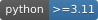
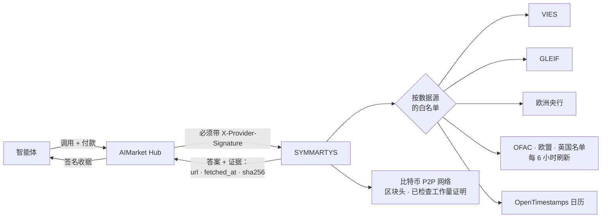
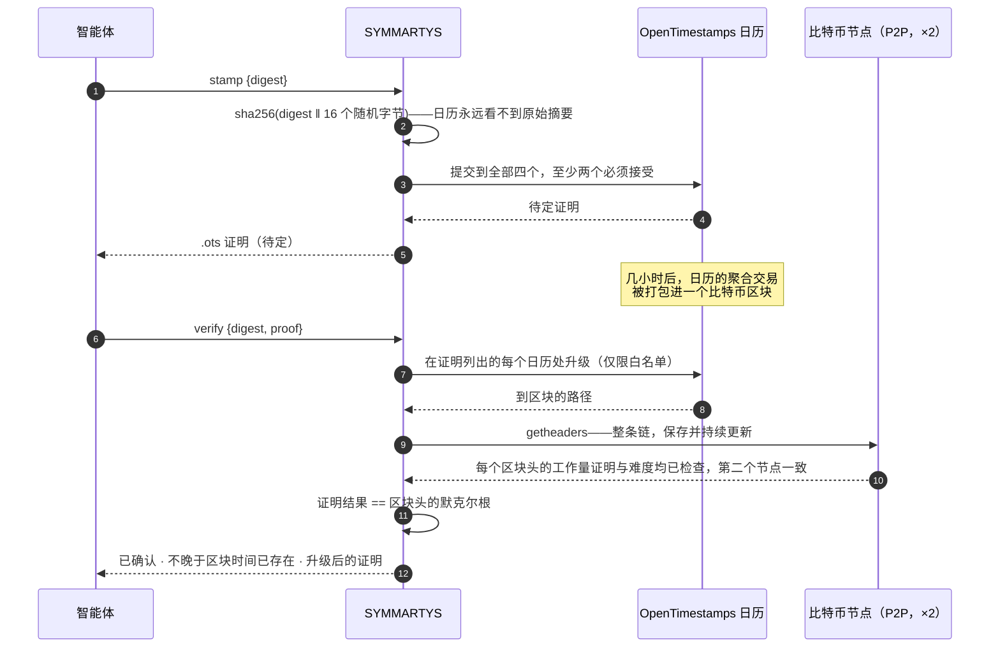
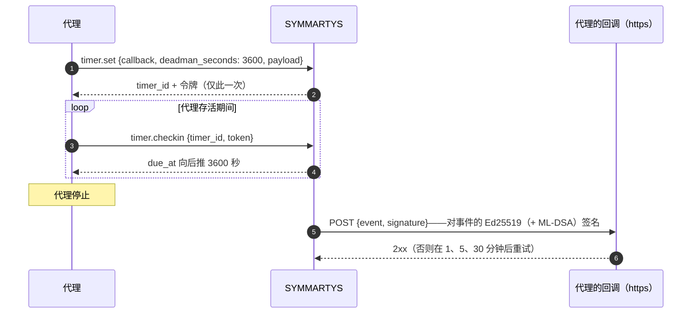

# SYMMARTYS — 面向交易型智能体的公共记录事实

Local 0.5.0 rename: `aimarket-symmartys`, product `symmartys`, capabilities `symmartys.*`. See [migration](MIGRATION.md); new public addresses require a separate deployment.

  

> 🌐 [English](README.md) · [Русский](README.ru.md) · [Español](README.es.md) · [Français](README.fr.md) · **中文**

一个买入、卖出或付款的智能体，需要任何模型都编造不出的事实：这个增值税号有效吗？这家公司是谁？
那天的欧元汇率是多少？这个钱包在制裁名单上吗？我能证明这份文件昨天就已存在吗？SYMMARTYS 从
**公共记录**——欧盟委员会、GLEIF、欧洲央行、美国财政部、欧盟、英国和比特币——回答每一个问题，
并在签名每个答案时附上**它来自哪里、何时获取，以及数据源返回内容的 SHA-256**。

*Symmartys*（συμμάρτυς）：共同见证者、佐证者——另一方能够核验的有据回答。

从 0.2.0 起，它也回答接下来的问题：这家公司在本国登记册里吗？它的 EORI 号能否用于海关？
这家网店的域名注册了多久？在巴伐利亚或 TARGET2 上第五个工作日是哪天？它还给代理两样任何模型
都没有的工具：**作为证据的网页快照**（锚定到比特币），以及**定时器**——包括“死人开关”——用签名
事件回调代理。

## 能力

| 能力 | 价格 | 回答什么 | 数据源 |
|---|---|---|---|
| `symmartys.vat.check@v1` | $0.002 | 这个欧盟增值税号今天有效吗？名称、地址、查询时间——如果把**你自己的**增值税号作为请求方，还会得到 VIES 的**查询编号**：以你的名义完成该查询的官方证明 | EU VIES |
| `symmartys.lei.lookup@v1` | $0.001 | 这个法人实体是谁？按 LEI（本地校验码验证）或按名称（排序后的候选）：法定名称、司法辖区、法律形式、状态、地址、续期、直接和最终母公司 | GLEIF（CC0） |
| `symmartys.fx.rate@v1` | $0.001 | 1999 年以来任意日期、任意货币对的欧元参考汇率，所属的欧洲央行日期，经欧元以 Decimal 计算的交叉汇率，按货币最小单位取整的金额 | 欧洲央行 |
| `symmartys.sanctions.screen@v1` | $0.002 | 这个钱包地址或名称在公开制裁名单上吗？OFAC SDN（约 1,050 个数字货币地址）、欧盟和英国名单（联合国制裁经由它们覆盖，每个命中附联合国编号），附每份名单的日期和 SHA-256 | OFAC · 欧盟 · 英国 |
| `symmartys.timestamp.stamp@v1` | $0.001 | 通过 OpenTimestamps 日历把 SHA-256 摘要锚定到比特币；返回标准 `.ots` 证明 | OpenTimestamps |
| `symmartys.timestamp.verify@v1` | $0.001 | 升级并验证证明：当其结果等于SYMMARTYS 直接从比特币网络获取并保存的区块头的默克尔根时（逐一检查每个区块头的工作量证明，链经两个节点确认），即为已确认 | 比特币 |
| `symmartys.web.capture@v1` | $0.003 | 把网页作为证据：最终 URL、每次重定向、IP、状态码、关键响应头、TLS 证书和正文的 SHA-256（以及正文本身，最多 512 KB）；记录的 SHA-256 锚定到比特币 | 网页本身 · OpenTimestamps |
| `symmartys.domain.rdap@v1` | $0.001 | 这个域名是谁、何时注册的：创建、到期、天数、注册商、状态、域名服务器、DNSSEC——或 `registered: false` | IANA 引导文件 → 该顶级域的注册局 |
| `symmartys.company.lookup@v1` | $0.001 | 这家公司真实存在且仍在经营吗？按编号或名称：名称、状态、法律形式、成立日期、地址、增值税号，以及登记册自己的字段 | Brønnøysund（挪威）· SIRENE/RNE（法国）· ARES（捷克）· PRH（芬兰）· Companies House（英国，需运营方密钥） |
| `symmartys.eori.check@v1` | $0.002 | 这个 EORI 号在欧盟海关有效吗？一次最多 10 个；经营者同意公开时附名称和地址 | 欧盟委员会（EOS） |
| `symmartys.calendar.check@v1` | $0.001 | 约 250 个国家（及地区）或市场（TARGET2、NYSE、LSE……）的工作日：节假日、下一个/上一个工作日、日期 + N 个工作日、两日期间的工作日数、某年的节假日 | python-holidays（离线） |
| `symmartys.timer.set@v1` | $0.002 | 在指定时间向你的 https 回调发送签名 POST，或设置“死人开关”：每 N 秒内不签到就触发 | — |
| `symmartys.timer.checkin@v1` · `.cancel@v1` · `.status@v1` | 免费 | 为死人开关签到、取消定时器、查看其状态（凭定时器令牌） | — |
| `symmartys.sources@v1` | 免费 | 每个数据源的许可与署名、当前持有的制裁名单、最新的欧洲央行日期 | — |



## 信任，简要说明

- **每个答案都带证据**——数据源 URL、获取时间和返回字节的 SHA-256，以及数据源的许可与署名。
- **两个签名**——网关的签名收据（oracle-core，Ed25519，`ORACLE_PQC=1` 时为混合 ML-DSA）和 Hub
  验证的、与请求绑定的 `X-Provider-Signature`。
- **无法作答的数据源不收费**——返回 `ok:false`，而 Hub 对 `ok:false` 不扣费：某国增值税登记系统
  宕机、制裁名单未加载或超过 48 小时、时间戳日历少于两个、区块头链尚未到达的区块。
- **出站请求按数据源设白名单**；重定向由程序手动跟随，且只跳转到同一数据源的主机；响应大小有上限。
- **会访问调用方指定 URL 的两项能力**（网页快照和定时器回调）只连接公网地址：仅 http(s)、
  端口 80/443，域名解析出的每个地址都要检查（不允许回环、私有、链路本地、CGNAT 或元数据地址），
  连接固定到已检查的地址，每次重定向重新检查，同一主机每分钟最多 20 次快照。

## 示例

```bash
H=https://symmartys.modelmarket.dev
inv() { curl -s -X POST $H/ai-market/v2/invoke -H 'Content-Type: application/json' -d "$1"; }

inv '{"capability_id":"symmartys.vat.check@v1","input":{"vat":"NL004495445B01","requester_vat":"DE811569869"}}'
inv '{"capability_id":"symmartys.lei.lookup@v1","input":{"name":"Deutsche Bank"}}'
inv '{"capability_id":"symmartys.fx.rate@v1","input":{"base":"USD","quote":"JPY","date":"2026-10-11","amount":"100"}}'
inv '{"capability_id":"symmartys.sanctions.screen@v1","input":{"address":"0x…"}}'
inv '{"capability_id":"symmartys.timestamp.stamp@v1","input":{"digest":"'"$(sha256sum contract.pdf | cut -d' ' -f1)"'"}}'
inv '{"capability_id":"symmartys.web.capture@v1","input":{"url":"https://shop.example/terms"}}'
inv '{"capability_id":"symmartys.domain.rdap@v1","input":{"domain":"shop.example"}}'
inv '{"capability_id":"symmartys.company.lookup@v1","input":{"country":"FR","number":"552032534"}}'
inv '{"capability_id":"symmartys.eori.check@v1","input":{"eori":"CZ00177041"}}'
inv '{"capability_id":"symmartys.calendar.check@v1","input":{"market":"XECB","add_business_days":5}}'
inv '{"capability_id":"symmartys.timer.set@v1","input":{"callback":"https://agent.example/hook","deadman_seconds":3600,"payload":{"release":"escrow-7"}}}'
```

通过 Hub 时，同样的调用会付费并获得收据：`POST https://modelmarket.dev/ai-market/v2/invoke`，
带 `"product_id":"symmartys"`。

### 增值税：查询编号

VIES 只向**作为请求方给出的有效欧盟增值税号**签发查询编号。它是请求方的证明，由请求方保存：把你
自己的号码作为 `requester_vat` 传入，答案中的查询编号就是以你的名义、证明你在 `checked_at` 核查过
交易对手的证据。不传时查询照常进行，答案会说明如何获得编号。

### 汇率：哪一天

某日期「的」汇率是该日期当天或之前欧洲央行最近一次发布的汇率，答案会写明那一天（`ecb_date`）：
周日按周五的汇率计，并且清楚可见。欧洲央行已停止报价的货币（自 2022 年 3 月起的卢布）会被拒绝，
而不是用多年前的汇率作答。

### 制裁：是查询，不是结论

钱包地址精确匹配（EVM 和 bech32 地址不区分大小写）。名称按词集合比较——不计顺序、大小写、重音和
法律形式（「DOE, John」就是「John Doe」）；有一处拼写错误的词计 0.9，绝不会被当作同一名称；
如果查询的所有词都出现在一个更长的名称中（父称、中间名），也算匹配。默认阈值为 0.85；每个命中都会
说明匹配的是哪个名称及其得分。

**命中是需要细看的理由；未命中不等于放行。** 名称会重名，别名并不完整。每个答案都会如此说明，并
列出所用名单及其发布日期和 SHA-256。过期的名单会被拒绝，而不是被使用。

**联合国制裁经由英国和欧盟名单覆盖。** 联合国安理会自己的文件没有再利用许可，因此 SYMMARTYS 不读取
它。英国制裁名单（Open Government Licence v3.0）为英国执行的每项联合国认定标注联合国编号，欧盟文件
也为部分条目标注：命中会带有 `un_ref`，而 `lists: ["UN"]` 只筛查带编号的英国和欧盟条目。截至
2026-10-17，三份名单合计包含全部 1010 条联合国条目（991 条按编号在英国名单中，其余按名称在欧盟和
OFAC 名单中）。最新的联合国决定会随英国和欧盟的执行延迟进入名单，通常为几天。

### 时间戳



证明是标准的 OpenTimestamps 文件：任何 OpenTimestamps 客户端都能验证，无需 SYMMARTYS。参考示例
（`hello-world.txt`）可验证到 2015-05-28 的第 358 391 号区块。

### 网页快照：页面当时说了什么

SYMMARTYS 像浏览器一样抓取一次页面，返回 `record`：请求的 URL、最终 URL、每次重定向及其状态码和
IP、时间、状态码、说明页面是什么的响应头（类型、长度、`Last-Modified`、`ETag`、`Date`、
`Server`……）、服务器出示的 TLS 证书（主体、签发者、有效期、名称、证书的 SHA-256）、页面标题和
`body_sha256`。正文不超过 512 KB 时以 `body_b64` 返回（单页上限 5 MB）。`record_sha256` 是记录
按键排序、紧凑分隔的 JSON 的 SHA-256，并通过 OpenTimestamps 锚定到比特币——之后可用
`symmartys.timestamp.verify@v1` 验证。404 也是快照（页面就是这么说的）；无法连接的主机或无法验证
的证书不收费。

### 定时器与死人开关



改用 `at`（带时区的 ISO 时间）或 `after_seconds` 则设置一次性回调。事件包含定时器 id、类型、计划
与实际触发时间、尝试次数和你的 payload（最多 4 KB）；签名使用 SYMMARTYS 签名清单中的密钥，对按键
排序、紧凑分隔的事件 JSON 签名。令牌只以 SHA-256 保存。定时器最长存活 90 天，存放在 SYMMARTYS
数据卷中的一个 SQLite 文件里。

### 公司登记册、EORI、域名、工作日

- **公司登记册**直接来自登记册本身：挪威 Brønnøysund 登记中心（NLOD 2.0）、经法国政府开放 API
  提供的 SIRENE 与国家登记册（Licence Ouverte 2.0）、捷克 ARES、芬兰 PRH（CC BY 4.0），以及——在
  运营方设置了免费密钥 `COMPANIES_HOUSE_API_KEY` 时——英国 Companies House（OGL v3.0）；没有密钥
  就不提供 GB。编号先在本地校验（挪威、捷克和芬兰的校验位；法国 SIRET 取其 SIREN）。状态：经营中、
  已停业/已解散/已注销、破产、清算中、重整中。
- **EORI** 来自欧盟委员会的 EOS 服务；“无效”也是答案。
- **RDAP** 只询问 IANA 引导文件为该顶级域指定的服务器（仅 https）；子域名或 URL 通过询问注册局
  归约为已注册的名称。部分国家顶级域（`.de`、`.ru`……）尚未提供 RDAP——此类请求被拒绝且不收费。
- **对 RDAP 的礼貌。** 注册局条款禁止高频自动查询和数据重新打包，因此 SYMMARTYS 对每个注册局每分钟
  最多查询 30 次，每个回答缓存 24 小时（“未注册”缓存 1 小时；缓存的回答标注 `cached: true` 并保留
  原始获取时间），并把注册局自己的通知（包括其使用条款）通过 `registry_terms` 原样转交。
- **个人数据。** 登记册中也有个体经营者，无论登记册采用何种许可，他们的记录都是个人数据。每个公司
  查询回答都带有 `personal_data`：目的（核实交易对手）、依据（正当利益，GDPR 第 6(1)(f) 条）和保存
  （SYMMARTYS 不保留副本；调用日志只保存输入的哈希）。
- **工作日**来自内置在 SYMMARTYS 中的 python-holidays：不联网，没有可宕机的东西；答案注明库的
  版本，因为该版本发布后才宣布的节假日不在其中。

## 诚实的限制

- VIES 回答的是该国登记系统此刻的回答；有些国家不返回名称和地址。SYMMARTYS 不存储任何内容。
- GLEIF 只覆盖拥有 LEI 的实体——许多小公司没有。
- 参考汇率仅供参考，不是交易汇率。
- 制裁筛查是在三份公开名单中的查询，不是法律意见或合规方案；不包括其他司法辖区的名单。
- 时间戳证明的是不晚于某区块时间就已存在，而不是作者身份。
- 快照显示的是服务器在那一刻回答 SYMMARTYS 的内容；其他访客、其他国家或不同 cookie 可能看到
  不同的页面。它不表示内容为真。
- 各登记册公开的内容不同；目前覆盖四个国家（有英国密钥时为五个）；波兰 KRS 的 API 在测试时没有响应。
- 回调在四次尝试内得到 2xx 即视为送达，至少送达一次；接收方应把 `due_at` 相同的重复
  `timer_id` 视为同一事件。

## 运行

```bash
# 在本仓库中
docker build -f symmartys/Dockerfile -t symmartys .
docker run -d --name symmartys -p 127.0.0.1:9351:9351 -v symmartys-data:/data \
  -e SYMMARTYS_PUBLIC_URL=http://127.0.0.1:9351 symmartys
curl -s http://127.0.0.1:9351/health
```

在 [aicom](https://github.com/alexar76/aicom) monorepo 中，同样的服务在其根目录用
`SYMMARTYS_VOLUME_NAME=symmartys-data docker compose -f symmartys/docker-compose.yml up -d --build` ([volume migration](MIGRATION.md); fresh installs first run `docker volume create symmartys-data`) 运行。`SYMMARTYS_PUBLIC_URL` 是买方访问
服务的地址，会写入签名的清单。

生产环境（在 aicom monorepo 中）：`./scripts/deploy_symmartys.sh --remote <主机>` 会把它发布在
`https://modelmarket.dev/providers/symmartys/`，位于现有 nginx 之后（一个片段文件，有备份，重载前
`nginx -t`），把正在运行的镜像保留为 `symmartys:prev`，并回滚无法健康启动的构建。常驻内存约 200 MB；
容器上限 768 MB。以 uid 10001 运行。它自己的地址是 https://symmartys.modelmarket.dev/：`/` 是给人看的
落地页，其余路径是给智能体用的同一套 API（[`deploy/nginx/symmartys.modelmarket.dev.conf`](../deploy/nginx/symmartys.modelmarket.dev.conf)）；
`/providers/symmartys/` 路径仍是枢纽联邦所用的地址。

| 变量 | 默认值 | 含义 |
|---|---|---|
| `SYMMARTYS_PUBLIC_URL` | `https://modelmarket.dev/providers/symmartys` | 清单中的基础 URL |
| `SYMMARTYS_PORT` | `9351` | 监听端口 |
| `SYMMARTYS_RATE_LIMIT` | `120` | 每个客户端每分钟调用次数 |
| `SYMMARTYS_CORS_ORIGINS` | 空（不允许浏览器来源） | CORS 白名单 |
| `COMPANIES_HOUSE_API_KEY` | 空（不提供 GB） | 运营方的免费 Companies House API 密钥 |
| `SYMMARTYS_TIMERS_DB` | 签名密钥旁的 `timers.sqlite` | 定时器的存放位置 |
| `ORACLE_PQC` | compose 中为 `1` | 混合 ML-DSA-65 签名 |

测试：`pip install -e "vendor/oracle-core[pqc]" -e '.[dev]' && pytest`（在 monorepo 中用
`-e ../oracles/core`）——175 个基于真实答案片段的测试，均不访问在线来源；在 monorepo 中，签名用的
规范字符串还会与 Hub 自身的函数逐字节比对。

## 数据源与许可

| 数据源 | 许可 | 答案中携带的署名 |
|---|---|---|
| EU VIES | 欧盟委员会再利用政策（第 2011/833/EU 号决定） | European Commission, VIES |
| GLEIF | CC0 1.0 | Global Legal Entity Identifier Foundation (GLEIF), CC0 |
| 欧洲央行 | 注明来源即可转载 | Source: European Central Bank |
| OFAC SDN | 美国政府作品（公有领域） | U.S. Department of the Treasury, OFAC |
| 欧盟金融制裁文件 | 欧盟委员会再利用政策 | European Commission, FSF |
| 英国制裁名单（FCDO） | Open Government Licence v3.0 | Contains public sector information licensed under the Open Government Licence v3.0 (UK Sanctions List, FCDO) |
| OpenTimestamps | 免费公共日历 | OpenTimestamps (opentimestamps.org) |
| 比特币区块头 | 公开链数据，点对点获取 | Bitcoin network |
| 欧盟 EORI（EOS） | 欧盟委员会再利用政策 | European Commission, EORI validation (EOS) |
| Brønnøysund 登记中心 | NLOD 2.0 | Brønnøysundregistrene, Enhetsregisteret (NLOD 2.0) |
| API Recherche d'entreprises | Licence Ouverte 2.0（Etalab） | DINUM, API Recherche d'entreprises (INSEE SIRENE, INPI RNE) |
| ARES | 捷克公共管理开放数据 | Ministerstvo financí ČR, ARES |
| PRH / YTJ | CC BY 4.0 | Finnish Patent and Registration Office (PRH), YTJ open data |
| Companies House（需密钥） | Open Government Licence v3.0 | Contains public sector information from Companies House, OGL v3.0 |
| RDAP | 公开注册数据（RFC 9083） | IANA RDAP 引导文件及该顶级域注册局 |
| python-holidays | MIT | python-holidays (vacanza/holidays) |

代码：MIT——见 [LICENSE](LICENSE)。所用的 OpenTimestamps 参考库为 LGPL-3.0。
