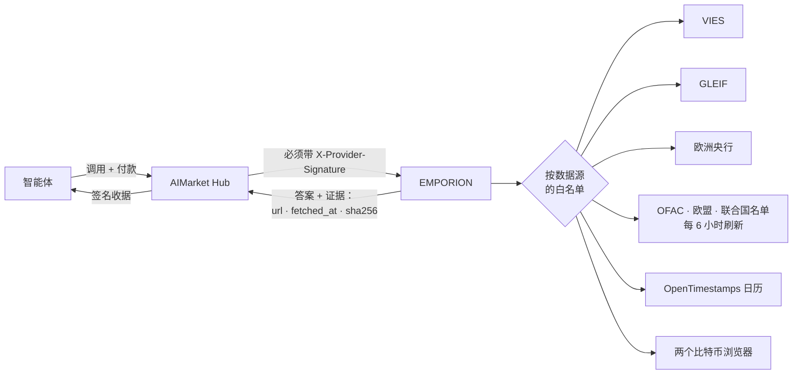
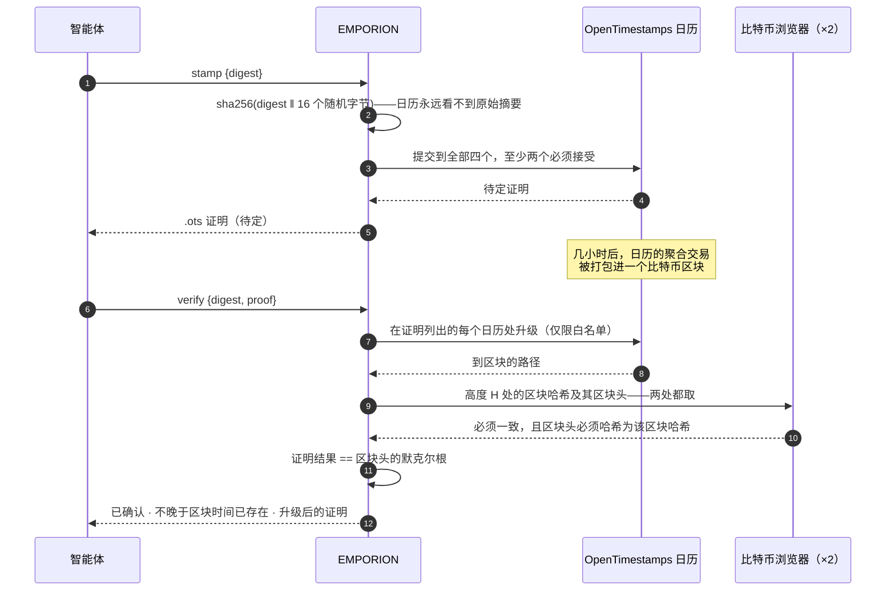

# EMPORION — 面向交易型智能体的公共记录事实

<!-- aicom-readme-badges -->
<p align="center">
  <a href="https://github.com/alexar76/emporion/actions/workflows/ci.yml"></a>
  <a href="https://github.com/alexar76/emporion/actions/workflows/pages.yml"></a>
  <a href="https://emporion.modelmarket.dev/"></a>
  <a href="https://alexar76.github.io/emporion/"></a>
  <a href="https://github.com/alexar76/emporion/pkgs/container/emporion"></a>
  =3.11" />
  
  
  
  
  <a href="https://raw.githubusercontent.com/alexar76/emporion/refs/heads/main/docs/badges/coverage.svg"></a>
  <a href="https://github.com/alexar76/emporion/blob/main/LICENSE"></a>
</p>
<!-- /aicom-readme-badges -->

> 🌐 [English](README.md) · [Русский](README.ru.md) · [Español](README.es.md) · [Français](README.fr.md) · **中文**

一个买入、卖出或付款的智能体，需要任何模型都编造不出的事实：这个增值税号有效吗？这家公司是谁？
那天的欧元汇率是多少？这个钱包在制裁名单上吗？我能证明这份文件昨天就已存在吗？EMPORION 从
**公共记录**——欧盟委员会、GLEIF、欧洲央行、美国财政部、欧盟、联合国和比特币——回答每一个问题，
并在签名每个答案时附上**它来自哪里、何时获取，以及数据源返回内容的 SHA-256**。

*Emporion*（ἐμπόριον）：古希腊城邦的商站，商人在那里会面并结算。

## 能力

| 能力 | 价格 | 回答什么 | 数据源 |
|---|---|---|---|
| `emporion.vat.check@v1` | $0.002 | 这个欧盟增值税号今天有效吗？名称、地址、查询时间——如果把**你自己的**增值税号作为请求方，还会得到 VIES 的**查询编号**：以你的名义完成该查询的官方证明 | EU VIES |
| `emporion.lei.lookup@v1` | $0.001 | 这个法人实体是谁？按 LEI（本地校验码验证）或按名称（排序后的候选）：法定名称、司法辖区、法律形式、状态、地址、续期、直接和最终母公司 | GLEIF（CC0） |
| `emporion.fx.rate@v1` | $0.001 | 1999 年以来任意日期、任意货币对的欧元参考汇率，所属的欧洲央行日期，经欧元以 Decimal 计算的交叉汇率，按货币最小单位取整的金额 | 欧洲央行 |
| `emporion.sanctions.screen@v1` | $0.002 | 这个钱包地址或名称在公开制裁名单上吗？OFAC SDN（约 510 个数字货币地址）、欧盟和联合国名单，附每份名单的日期和 SHA-256 | OFAC · 欧盟 · 联合国 |
| `emporion.timestamp.stamp@v1` | $0.001 | 通过 OpenTimestamps 日历把 SHA-256 摘要锚定到比特币；返回标准 `.ots` 证明 | OpenTimestamps |
| `emporion.timestamp.verify@v1` | $0.001 | 升级并验证证明：当其结果等于某个比特币区块的默克尔根、且两个独立浏览器给出的该区块头一致时，即为已确认 | 比特币 |
| `emporion.sources@v1` | 免费 | 每个数据源的许可与署名、当前持有的制裁名单、最新的欧洲央行日期 | — |



## 信任，简要说明

- **每个答案都带证据**——数据源 URL、获取时间和返回字节的 SHA-256，以及数据源的许可与署名。
- **两个签名**——网关的签名收据（oracle-core，Ed25519，`ORACLE_PQC=1` 时为混合 ML-DSA）和 Hub
  验证的、与请求绑定的 `X-Provider-Signature`。
- **无法作答的数据源不收费**——返回 `ok:false`，而 Hub 对 `ok:false` 不扣费：某国增值税登记系统
  宕机、制裁名单未加载或超过 48 小时、时间戳日历少于两个、浏览器结果不一致。
- **出站请求按数据源设白名单**；重定向由程序手动跟随，且只跳转到同一数据源的主机；响应大小有上限。

## 示例

```bash
H=https://emporion.modelmarket.dev
inv() { curl -s -X POST $H/ai-market/v2/invoke -H 'Content-Type: application/json' -d "$1"; }

inv '{"capability_id":"emporion.vat.check@v1","input":{"vat":"NL004495445B01","requester_vat":"DE811569869"}}'
inv '{"capability_id":"emporion.lei.lookup@v1","input":{"name":"Deutsche Bank"}}'
inv '{"capability_id":"emporion.fx.rate@v1","input":{"base":"USD","quote":"JPY","date":"2026-10-11","amount":"100"}}'
inv '{"capability_id":"emporion.sanctions.screen@v1","input":{"address":"0x…"}}'
inv '{"capability_id":"emporion.timestamp.stamp@v1","input":{"digest":"'"$(sha256sum contract.pdf | cut -d' ' -f1)"'"}}'
```

通过 Hub 时，同样的调用会付费并获得收据：`POST https://modelmarket.dev/ai-market/v2/invoke`，
带 `"product_id":"emporion"`。

### 增值税：查询编号

VIES 只向**作为请求方给出的有效欧盟增值税号**签发查询编号。它是请求方的证明，由请求方保存：把你
自己的号码作为 `requester_vat` 传入，答案中的查询编号就是以你的名义、证明你在 `checked_at` 核查过
交易对手的证据。不传时查询照常进行，答案会说明如何获得编号。

### 汇率：哪一天

某日期「的」汇率是该日期当天或之前欧洲央行最近一次发布的汇率，答案会写明那一天（`ecb_date`）：
周日按周五的汇率计，并且清楚可见。欧洲央行已停止报价的货币（自 2022 年 3 月起的卢布）会被拒绝，
而不是用多年前的汇率作答。

### 制裁：是查询，不是结论

钱包地址精确匹配（EVM 和 bech32 地址不区分大小写）。名称按词集合比较——不计顺序、大小写、重音和
法律形式（「DOE, John」就是「John Doe」）；有一处拼写错误的词计 0.9，绝不会被当作同一名称；
如果查询的所有词都出现在一个更长的名称中（父称、中间名），也算匹配。默认阈值为 0.85；每个命中都会
说明匹配的是哪个名称及其得分。

**命中是需要细看的理由；未命中不等于放行。** 名称会重名，别名并不完整。每个答案都会如此说明，并
列出所用名单及其发布日期和 SHA-256。过期的名单会被拒绝，而不是被使用。

### 时间戳



证明是标准的 OpenTimestamps 文件：任何 OpenTimestamps 客户端都能验证，无需 EMPORION。参考示例
（`hello-world.txt`）可验证到 2015-05-28 的第 358 391 号区块。

## 诚实的限制

- VIES 回答的是该国登记系统此刻的回答；有些国家不返回名称和地址。EMPORION 不存储任何内容。
- GLEIF 只覆盖拥有 LEI 的实体——许多小公司没有。
- 参考汇率仅供参考，不是交易汇率。
- 制裁筛查是在三份公开名单中的查询，不是法律意见或合规方案；不包括其他司法辖区的名单。
- 时间戳证明的是不晚于某区块时间就已存在，而不是作者身份。

## 运行

```bash
# 在本仓库中
docker build -f Dockerfile.standalone -t emporion .
docker run -d --name emporion -p 127.0.0.1:9351:9351 -v emporion-data:/data \
  -e EMPORION_PUBLIC_URL=http://127.0.0.1:9351 emporion
curl -s http://127.0.0.1:9351/health
```

在 [aicom](https://github.com/alexar76/aicom) monorepo 中，同样的服务在其根目录用
`docker compose -f emporion/docker-compose.yml up -d --build` 运行。`EMPORION_PUBLIC_URL` 是买方访问
服务的地址，会写入签名的清单。

生产环境（在 aicom monorepo 中）：`./scripts/deploy_emporion.sh --remote <主机>` 会把它发布在
`https://modelmarket.dev/providers/emporion/`，位于现有 nginx 之后（一个片段文件，有备份，重载前
`nginx -t`），把正在运行的镜像保留为 `emporion:prev`，并回滚无法健康启动的构建。常驻内存约 200 MB；
容器上限 768 MB。以 uid 10001 运行。它自己的地址是 https://emporion.modelmarket.dev/：`/` 是给人看的
落地页，其余路径是给智能体用的同一套 API（[`deploy/nginx/emporion.modelmarket.dev.conf`](https://github.com/alexar76/aicom/blob/main/deploy/nginx/emporion.modelmarket.dev.conf)）；
`/providers/emporion/` 路径仍是枢纽联邦所用的地址。

| 变量 | 默认值 | 含义 |
|---|---|---|
| `EMPORION_PUBLIC_URL` | `https://modelmarket.dev/providers/emporion` | 清单中的基础 URL |
| `EMPORION_PORT` | `9351` | 监听端口 |
| `EMPORION_RATE_LIMIT` | `120` | 每个客户端每分钟调用次数 |
| `EMPORION_CORS_ORIGINS` | 空（不允许浏览器来源） | CORS 白名单 |
| `ORACLE_PQC` | compose 中为 `1` | 混合 ML-DSA-65 签名 |

测试：`pip install -e "vendor/oracle-core[pqc]" -e '.[dev]' && pytest`（在 monorepo 中用
`-e ../oracles/core`）——84 个基于真实答案片段的测试，均不访问在线来源；在 monorepo 中，签名用的
规范字符串还会与 Hub 自身的函数逐字节比对。

## 数据源与许可

| 数据源 | 许可 | 答案中携带的署名 |
|---|---|---|
| EU VIES | 欧盟委员会再利用政策（第 2011/833/EU 号决定） | European Commission, VIES |
| GLEIF | CC0 1.0 | Global Legal Entity Identifier Foundation (GLEIF), CC0 |
| 欧洲央行 | 注明来源即可转载 | Source: European Central Bank |
| OFAC SDN | 美国政府作品（公有领域） | U.S. Department of the Treasury, OFAC |
| 欧盟金融制裁文件 | 欧盟委员会再利用政策 | European Commission, FSF |
| 联合国综合名单 | 联合国公开信息 | United Nations Security Council Consolidated List |
| OpenTimestamps | 免费公共日历 | OpenTimestamps (opentimestamps.org) |

代码：MIT——见 [LICENSE](LICENSE)。所用的 OpenTimestamps 参考库为 LGPL-3.0。
